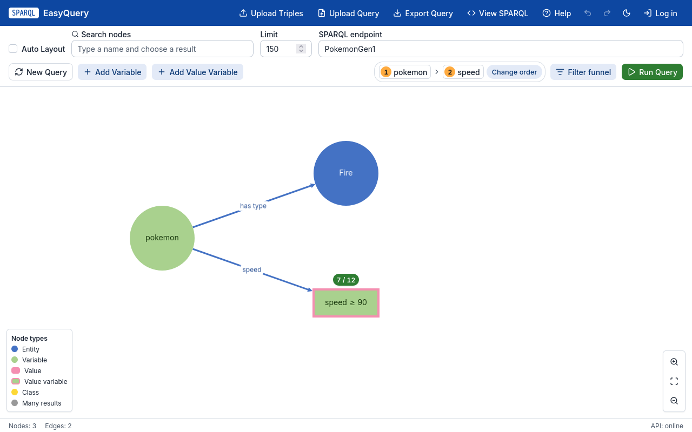
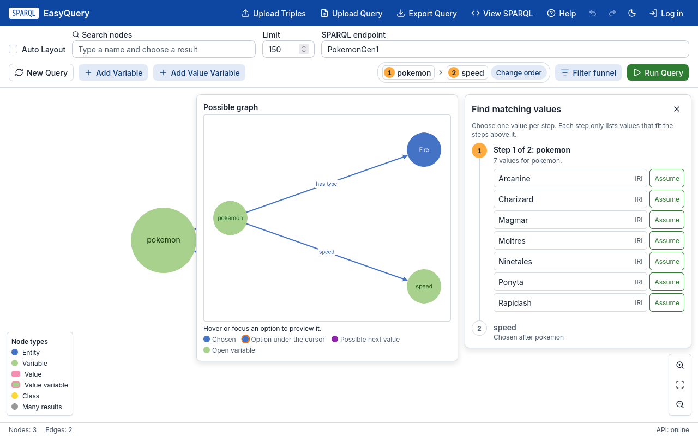

# SPARQL EasyQuery

SPARQL EasyQuery lets people query RDF knowledge graphs without writing
SPARQL. You draw the question as a graph: entities, unknowns (variables) and
the relations between them. The app turns the drawing into SPARQL, runs it on
a built-in dataset or any SPARQL endpoint (Wikidata, for example), and helps
you narrow the answer step by step.



The question above, "which Fire-type Pokémon have a speed of at least 90?",
is the worked example of the in-app guide at `/help`, on the built-in
PokemonGen1 dataset (the first 151 Pokémon), which the editor opens on.

## Features

**Visual query editor**
- Graph canvas (Cytoscape) with entities, classes, values, variables and
  value variables; search the dataset to add nodes, explore an entity's
  relations, connect nodes with a chosen or a variable predicate, Alt+drag to
  draw relations, undo/redo, auto layout, light and dark themes.
- Variables get readable names from the graph (the class they have, or the
  relation that leads to them: Pokémon, Speed) instead of generated SPARQL
  names; the query keeps its real variable names.
- View SPARQL shows the generated query with a Copy button, so users learn the
  language as they go.
- Upload Turtle triples to query your own data; export and reload queries as
  files.
- Guided tour of the editor and a `/help` guide with screenshots that one
  command regenerates.

**Exploring results step by step**
- Run Query explores the variables one at a time in an order the user
  chooses: each step lists only the values that fit the choices already made,
  hovering a value previews the graph it leads to, and Assume applies a value
  to the graph at once.
- Filters on values: comparisons, text matching, ranges, and MAX/MIN that keep
  every tie. The filter editor shows the real data: a histogram for numbers
  with the kept part highlighted, suggestions for text.
- The filter funnel shows how each filter narrows the result
  (151 Pokémon → 12 Fire-type → 7 fast ones); untick a step to see the result
  without it. Badges on filtered nodes show how many values they keep.



**Accounts and a built-in user study**
- Self-registration and login with Argon2id password hashes and server-side
  sessions in PostgreSQL; participant and admin roles guard the routes.
- Admins draw reference queries as tasks, put participants in groups and give
  each group its own tasks. Participants solve the tasks in the editor; the
  server runs each submitted query, compares it with the expected result
  (set or multiset) and stores every attempt. The client never decides
  correctness.
- Versioned research consent, two questionnaires validated by the same rules
  in the browser and on the server, and CSV export of the responses.

## Architecture

```
Browser (SvelteKit SPA)          Caddy                Ktor (Kotlin/JVM)            Data
┌──────────────────────┐   ┌───────────────┐   ┌──────────────────────────┐   ┌──────────────────┐
│ graph editor         │   │ static files  │   │ HTTP routes + OpenAPI    │   │ built-in RDF      │
│ query store (runes)  │──▶│ /api proxy    │──▶│ query generation (SPARQL)│──▶│ (Apache Jena)     │
│ typed API client     │   │ HTTPS         │   │ auth, study, admin       │   │ remote endpoints  │
└──────────────────────┘   └───────────────┘   └────────────┬─────────────┘   │ (Wikidata, ...)   │
                                                             │                 └──────────────────┘
                                                             ▼
                                                  PostgreSQL (Exposed, Flyway)
```

- **Backend:** Kotlin 2.2 on JDK 21, Ktor 3 (Netty), Apache Jena 6 for RDF
  and SPARQL, Exposed + HikariCP + Flyway on PostgreSQL 17, Logback. Jena types
  stay inside the RDF layer; HTTP and application code use their own types.
  The API is about 40 routes: query building and staged exploration
  (`/api/query/*`), endpoints and uploads, auth, study and admin.
- **API contract:** OpenAPI 3.1 and Swagger UI are generated from the Ktor
  routes. A snapshot test fails on drift, and the frontend's TypeScript client
  types are generated from the same document.
- **Frontend:** Svelte 5 and SvelteKit (static SPA), TypeScript, Tailwind CSS 4
  with design tokens and shadcn-svelte components, TanStack Query, Zod.
  Query logic is a pure, tested domain layer; Cytoscape is only a view of
  the store.
- **Operations:** Docker Compose runs PostgreSQL, the backend and Caddy on one
  origin. HTTPS comes from Caddy's own certificates or from an upstream proxy,
  chosen with one setting. Backups run on a schedule with retention,
  age-encrypted off-host copies and a scripted restore drill. Logs are
  rotated, services have memory limits, images are tagged by release, and
  `GET /health` reports database connectivity. A runbook covers install,
  update, rollback, restore and secret rotation.

## Quality and automation

- **Testing in layers:** Kotlin unit and route tests (PostgreSQL through
  Testcontainers), Vitest for the domain and stores, Vitest browser-mode
  component tests, offline Playwright end-to-end tests against a typed mock
  API (MSW), and a real-stack Playwright suite that starts Ktor with an empty
  database.
- **Visual and accessibility checks:** canvas and full-page screenshot tests in
  both themes (in a pinned Playwright container), and axe accessibility checks
  on every main route.
- **No network in normal tests:** browser tests fail on any unexpected
  external request. Live Wikidata tests are opt-in.
- **Compatibility oracles:** recorded requests and responses keep the current
  backend and frontend wire-compatible with the original application.
- **CI (GitHub Actions):** ktlint, detekt and the Kotlin tests; type checks,
  lint, unit and component tests with coverage; the browser, screenshot and
  real-stack suites; a smoke test of the whole Compose stack through Caddy.
  It runs on pull requests, on pushes to `main` and nightly.

## Development workflow

Work is planned and tracked in an Obsidian knowledge base under `tcc/`:
architecture and decision records, current API and UI contracts, and one task
card per change with its acceptance criteria and the checks that proved it.
Development is AI-assisted: `AGENTS.md` sets the rules every coding agent
follows (scope, contracts, which test gates to run, one focused commit per
task), and `.agents/skills/` holds repeatable procedures for backend,
frontend, full-stack, refactoring, testing and UI-style work. Every change
still has to pass the same tests and CI as hand-written code.

## Run locally

Requirements: JDK 21, Node.js 22 and Docker.

1. Optional, for accounts and the study: start only PostgreSQL. Copy
   `.env.example` to `.env`, set `POSTGRES_PASSWORD` and the
   `EASYQUERY_DB_URL/USER/PASSWORD` values `.env.example` lists, then run:

   ```sh
   docker compose -f compose.yaml -f compose.dev.yaml up -d --wait db
   ```

2. Start the Ktor API on port 8080 (Flyway migrates the database at startup;
   query routes work without a database):

   ```sh
   ./gradlew run
   ```

3. Install and start the frontend:

   ```sh
   (cd frontend && npx npm@11 ci && npm run dev)
   ```

4. Open `http://localhost:5173/`. The guide is at `/help` and Swagger UI at
   `http://localhost:8080/swagger`.

To run the whole stack as it runs in production (PostgreSQL, Ktor, Caddy
serving the built app), set `POSTGRES_PASSWORD` in `.env` and run
`docker compose up -d --build --wait`, then open `http://localhost:8080/`.
See the [Compose runbook](tcc/07%20-%20Operations/Docker%20Compose%20Stack.md).

## Verification

```sh
./gradlew ktlintCheck detekt test
npm --prefix frontend run check
npm --prefix frontend run lint
npm --prefix frontend test
npm --prefix frontend run test:stack
```

The Kotlin tests and `test:stack` need a running Docker daemon for
Testcontainers. `npm --prefix frontend run test:screens` runs the screenshot
tests in the pinned Playwright image.

## Status

The application is feature-complete for its user study. Production hosting
on the university server is prepared but not live yet: the domain, HTTPS mode,
monitoring and deploy automation wait for the server's IT answers
([checklist](tcc/07%20-%20Operations/University%20Server%20Checklist.md)), and
upload and cache limits wait for a decision (SEC-001).

## History

The first version was an ASP.NET Core/.NET 8 application with dotNetRDF and a
jQuery page. The backend was rewritten in Kotlin, Ktor and Apache Jena,
checked against captured responses from the C# version, and the frontend was
rebuilt in SvelteKit until every behavior of the old page passed on the new
one. The C# source remains recoverable from commit `0f20091`; see
[MIGRATION.md](MIGRATION.md) and [MIGRATION_REPORT.md](MIGRATION_REPORT.md).

## Documentation

- [Knowledge-base home](tcc/00%20-%20Home.md) and [task index](tcc/90%20-%20Tasks/TASKS.md)
- [Current contracts](tcc/09%20-%20Decisions/Current%20Contracts.md)
- [Frontend architecture](tcc/04%20-%20Frontend/Frontend%20Architecture.md)
- [Testing guide](tcc/08%20-%20Quality/Testing%20Guide.md)
- [Server deploy runbook](tcc/07%20-%20Operations/Server%20Deploy%20Runbook.md)
- [Characterization corpus](compatibility/README.md)

## Source landmarks

- `src/main/kotlin/com/example/sparqlqueryeasy/Application.kt`: entry point.
- `src/main/kotlin/com/example/sparqlqueryeasy/http/`: Ktor routes and the
  OpenAPI module.
- `src/main/kotlin/com/example/sparqlqueryeasy/application/`: query
  generation, exploration, auth and study services; `rdf/jena/` holds the
  Jena adapters.
- `frontend/src/lib/domain/`: the pure query model; `frontend/src/lib/features/`:
  the editor, exploration, filters, funnel, study and admin screens.
- `compose.yaml`, `deploy/`: Compose stack, Caddy and backups.
- `.github/workflows/ci.yml`: CI.
