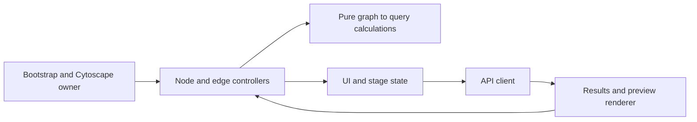

# Frontend Evolution Audit

DEV-001, 2026-09-28. Analysis only: no application code, dependency or bundler
was changed. At audit time, follow-up cards remained BACKLOG.

**Direction revised 2026-10-16 (DEC-011).** The user chose a SvelteKit
rewrite in `frontend/`, built beside `index2.html` and cut over by FE-049.
The Option B work and the analysis below remain valid evidence: the node-kind
rules are ported first as a framework-free TypeScript domain (FE-042).
See [[../90 - Tasks/items/DEC-011-frontend-stack-decision]].

## Incremental Option B follow-up (2026-09-28)

The user selected a bounded Option B step and deferred a full frontend port.
`sparql/query-calculations.js` now owns pure filter construction, distinct
variable discovery and parallel-predicate detection. `sparql/index2.html`
retains Cytoscape, event handling and global adapters; browser assets remain
unbundled and are served by Ktor. `tsconfig.frontend.json` checks only the new
module with TypeScript 5.9.3, JSDoc, `checkJs` and `noEmit`; no runtime TypeScript
artifact or Vite build exists. `npm run test:query` executes DOM-free tests and
`npm run check:frontend-types` runs the static check.

The checked shape distinguishes optional graph fields and a numeric or null
filter result, so an incompatible query-item field or return type is a static
error inside the module. The existing inline Cytoscape adapter, HTTP response
shapes, asynchronous preview state and menu lifecycle are still unchecked.
Extending Option B will require typed adapters/API DTOs and a deliberate
packaging decision if a bundler is introduced. Type checking is not evidence
of race safety. Browser tests now fail on unexpected external requests and
serve pinned local Materialize CSS and deterministic Intro styling fixtures;
production still references
CDN assets and remains a separate offline-packaging decision.

Source files: `sparql/query-calculations.js`, `sparql/index2.html`,
`tsconfig.frontend.json`, `package.json`, `frontend-tests/query-calculations.unit.mjs`,
`frontend-tests/index2.spec.mjs`, `build.gradle.kts`.

## Size review for agent-sized edits (FE-018, 2026-09-28)

Analysis only; no application code changed. `sparql/index2.html` grew from
1,558 lines (`beb7058`) to 3,001 lines / 144 KB (`6b5df75`), about 36k tokens
(estimate: bytes ÷ 4). Each FE card since FE-002 added 20–330 lines to this one
file, so an agent must read or search the whole page even for a menu or CSS
change. The pure modules (`query-calculations.js`, `query-stages.js`, 383
lines) are the only parts with DOM-free tests and type checks.

| Lines | Region | Coupling |
|---|---|---|
| 12–499 | Inline CSS, one comment header per UI area | None; plain `<link>` move |
| 502–807 | Markup: toolbar, canvas, panel, possible-graph window, modals | Needed by tests and Materialize init |
| 820–1284 | Config, globals, utilities, modals, API calls, graph operations | Top-level functions; tests call `runQuery`, `getQuery`, `seeSparqlQuery`, `getElementInfo`, `getRelationshipValue`, `addNewVariable` on `window` |
| 1285–1434 | Variable registry bridge, stage-order blocks, panel | Uses `window.queryStages` |
| 1435–1899 | Staged exploration and possible-graph window | Timer, `AbortController`, stage cache |
| 1900–2086 | Node factory, connection discovery, change-value modal | Top-level functions |
| 2089–2999 | `DOMContentLoaded`: Materialize, uploads, autocomplete, Cytoscape init, node menu (≈345), edge menu (≈120), Alt+drag, selection | Closure locals such as `selectedMenuNodeId`, `pendingConnection`, `predicateChoices` shared by menus |

No function is unused. `possibleGraphState()`, `nodeActions()`,
`edgeActions()` and `nextPredicateVariableName()` are mainly data decisions
mixed with timers or DOM. 15 inline `onclick` attributes depend on globals.

**Recommendation:** continue Option A/B with files split by responsibility,
not by line count. Top-level code moves to ordered classic
`<script src>` files first, so global functions and the `window` contract used
by tests and inline handlers stay unchanged without a bridge. Every new file
must be added to the `processResources` include list in `build.gradle.kts` and
to the packaged-resource test; the Playwright server already serves any file
under `sparql/`. No bundler or framework is needed for this.

| Card | Slice | Estimated effect |
|---|---|---|
| FE-019 | Move inline CSS to `index2.css` | −488 lines, no JS change |
| FE-020 | Move top-level script (820–2086) to ordered classic files: core/API, stage order, exploration, graph nodes | Page ≈1,250 lines; largest file ≈470 |
| FE-021 | Move pure possible-graph, menu-action and naming decisions into checked modules | New unit tests |
| FE-022 | Move node/edge menus and connection preview out of `DOMContentLoaded` into a controller that owns its state | Page ≈330 lines (markup + includes) |

**Outcome (2026-09-28):** FE-019–FE-022 are done. `index2.html` is 672 lines
(markup, script includes and bootstrap). The largest application scripts are
`graph-menus.js` (582 lines, both menus plus connection handling) and
`stage-exploration.js` (444). QUAL-004 fixed a startup-layout race in the
browser tests found while validating these slices.

Acceptance for each slice: identical browser suite, `npm run test:query`,
`npm run check:frontend-types` where modules change, and the Gradle packaged-
resource test. Rollback is reverting that slice's commit. Expected end state:
no application file above about 500 lines, and each FE card touches one or two
responsibility files plus markup.

Correction (FE-021): the audit first said `possibleGraphStyle()` repeated the
main graph style. It does not: the main graph uses 120 px nodes, `getNodeColor`
and HTML labels; the possible graph uses 60 px nodes and state classes. Only
the edge color and arrow match, so no shared style was extracted.

## Reliability proposal (FE-031, 2026-10-09)

Analysis only; no application code changed. The user reported that each
frontend change has caused new bugs, value-node interactions in particular.
The file split (FE-018–FE-022) made the files smaller, but it did not change
how they work together.

**Evidence: recent bugs share one cause.** BUG-003, BUG-005 and BUG-006 and the
FE-030 follow-up (`834d00d`) all came after features shipped. None came from a typo. Each
happened because one path decided what a graph element *is* (IRI, literal,
variable, filtered value) differently from another path:

- BUG-006: `getRelationshipValueChange` assumed `isLiteral: true`, so a fixed
  IRI neighbour came back as a literal node.
- BUG-005: the legacy query dropped untyped literals that the staged query
  returns, so the two paths disagreed about which values exist.
- BUG-003: one replacement path added a node with an existing ID; FE-010
  Apply already reused it.

**What the code shows (`main`, `5d64c4a`):**

| Finding | Evidence |
|---|---|
| A node's kind is a free-form string, with other facts stored elsewhere | `data.type` is `node`, `label`, `default`, `variable` or `label-filter`. "N results" is `color: 'gray'`, images are `isLink`, and being a variable is also inferred from an ID starting with `?` |
| Every feature decides the kind again | About 70 `type`/`filterType` checks and 15 `?`-prefix checks across 8 files (`rg` count) |
| A filtered value is a literal node with its filter on the edge | The `object` holds the filter text (`40..80`) and the edge holds `filterType`. The server adds a hidden `?lit` (API v1), so the filter is not a real query variable |
| RDF terms are lost when written to the graph | Staged results are typed `RdfTerm`s (`query-stages.js`), but graph nodes keep only the lexical form plus `type` (Two Variable Exploration Contract, FE-010). Datatype and language are lost |
| "Replace a variable with a value" exists twice | `replaceWithNewNode` (`graph-nodes.js`, results table) and `replaceVariableNodeWithTerm` (`stage-exploration.js`, Apply/Assume) have different rules for neighbours and relationship requests |
| Graph-changing code is untested below the browser level | 28 `cy.add`/`remove`/`move` sites in `app-core`, `graph-menus`, `graph-nodes` and `stage-exploration`. None of these files is type-checked (`tsconfig.frontend.json` covers 3 pure modules) or unit-tested; only the 73 Playwright cases reach them |

**Not the cause:** file size, jQuery and the lack of a framework. A component
framework would still need these same kind rules and the same Cytoscape
code, so Option C stays rejected (see the options table below).

**Verified for this proposal:** the bundled Cytoscape 3.29.1 runs headless in
Node when loaded as a global script
(`cytoscape({headless: true})`, `edge.move` checked). Graph-changing
functions can therefore get fast `node --test` tests on a real Cytoscape
graph without a browser or a new dependency.

**Proposal (Option B continued, four reversible slices):**

1. **QUAL-005, safety net first.** Write the value-node bugs the user sees
   as failing browser cases, then add a table of every node kind against every
   action (results table, Assume, Apply, Convert, Edit/Add value filter,
   Remove, Connect). Each row checks the resulting kinds, IDs and query
   payload. Fix the reproduced bugs in this card.
   *Done 2026-10-14: the table is in `index2.spec.mjs`. No bugs were reported;
   the three Convert-to-variable bugs it found are fixed (see the QUAL-005
   card).*
2. **FE-032, one kind model.** A checked `graph-model.js` owns
   `elementKind(data)` (`iri`, `literal`, `class`, `variable`, `many`, plus the
   filter) and the factory that writes node data from an `RdfTerm`. Callers
   stop comparing `type` strings. Behavior-preserving; the stored field values
   stay the same so imports and tests still work.
3. **FE-033, one way to bind a variable.** A single `bindVariable(cy, id,
   term, options)` used by the results table, Assume and Apply. The
   differences that exist on purpose (the legacy relationship re-fetch) become
   explicit options. It gets headless-Cytoscape unit tests and type checking.
4. **Every later FE card** adds its node kind or action to the QUAL-005 table
   and its graph-changing code to the checked/headless-tested set. FE-034
   (the variable value node) is the first card under this rule.

Success criteria: the table covers every kind/action pair; a new node kind
changes `graph-model.js` and adds table rows instead of edits across files;
the `type`-string checks outside `graph-model.js` go to zero. Rollback is
reverting a slice's commit. The cost is a few small, behavior-preserving
cards before FE-034; they are estimates, not measured.

## Evidence and concentration

Confirmed: `sparql/index2.html` is 2,221 lines. Inline application JavaScript
starts at line 629; DOMContentLoaded initialization starts at 1337. The file
combines styles, markup, filters, API calls, result application and graph/menu
listeners. Line count describes concentration, not a performance measurement.
Globals include `cy`, `searches`, `trData` and the menu controller. Inline HTML
handlers and browser tests call functions such as `runQuery` via `window`.

Confirmed: jQuery 2.1.1 is loaded and `$.ajax` is used for query, relationship,
upload and search requests. Materialize, Intro.js and cytoscape-html-label are
external scripts; Cytoscape is local. External Materialize/Intro CSS and Google
icon fonts remain. Playwright stubs the external JavaScript but has no general
external-request failure guard. This confirms the previously noted offline
limitation by source inspection; no new browser run was made for this audit.

Confirmed: `build.gradle.kts` copies six named frontend files into classpath
`frontend`; Ktor serves that directory via `staticResources`. The test server
serves source files and synthetic API responses independently of Ktor. There
is no configured application bundler, type checker or pure-JS unit-test script.

## Four evaluation scenarios

| Scenario | Concrete change pressure |
|---|---|
| FE-009 numbered reorder menu | Stable variable identity/order should be calculated independently of drawing and event handlers |
| FE-006 hover candidate preview | Query signature, temporary binding, request cancellation and stale-response rejection need explicit state ownership |
| Fixed predicate-result bug | `getQuery` must choose edge binding, not node replacement; tests assert unchanged topology/metadata |
| Fixed parallel-predicate bug | `hasParallelPredicateVariables` must reject parallel alternatives without mistaking them for a chain; tests assert no API call |

The last two are historical fixes in current code, not newly observed failures.
Current multi-variable support remains a foundation: exactly two opens the
panel without requests; larger counts fall through legacy projection choice.
Do not convert this finding into a behavior change during extraction.

## Options (qualitative estimates, not benchmarks)

| Criterion | A: small native JS modules, existing UI | B: modules plus TypeScript/JSDoc checking and optional Vite | C: component-framework rewrite |
|---|---|---|---|
| Initial scope | Extract query calculations, bridge current globals, package new files | A plus compiler/config/types and build artifact integration if Vite chosen | Rework toolbar/menus/state/lifecycle and much browser initialization |
| Context per task | Query or menu module plus entry adapter | Similar modules with explicit type contracts | Components plus graph adapter, store and build system |
| Locality | Good if responsibilities, not arbitrary line chunks, define modules | Better checks at module boundaries | UI locality possible; graph still needs an adapter |
| Pure tests | Node can exercise detached graph-data calculations | Same, plus static checking | Domain must still be extracted separately |
| Bug prevention | Identity/state invariants tested explicitly | Can detect type mismatches; runtime races still need tests | Component lifecycle helps ownership only if used correctly; not a race guarantee |
| Cytoscape ownership | One bootstrap owns `cy`; controllers attach/detach named listeners | Same owner with typed boundary | Framework owns UI DOM; dedicated canvas adapter owns Cytoscape, not both |
| API alignment | Contract fixtures checked against DTO/route tests | Types help locally; still need DTO/OpenAPI boundary checks | Same contract work remains |
| Ktor/offline operation | Add JS resources to Gradle; keep same-origin static serving | If bundled, copy generated assets and resolve manifest; localize dependencies separately | Requires new artifact/asset integration and dependency policy |
| Thesis schedule | Lowest estimated transition cost for FE-008/009 | Useful after extraction if type errors or asset complexity justify it | Highest estimated transition cost without evidence current features need it |

Finalists are A and incremental B. Native modules require correct JS MIME
types and do not automatically export names onto `window`; retain a narrow
bridge for current handlers while extracting. See [MDN modules](https://developer.mozilla.org/en-US/docs/Web/JavaScript/Guide/Modules).
TypeScript can check existing JavaScript with `checkJs`/JSDoc, allowing a
limited pilot without converting all files. See [TypeScript JavaScript checking](https://www.typescriptlang.org/docs/handbook/type-checking-javascript-files.html).
Vite's backend integration uses build artifacts/manifest and a distinct dev
entry; adopting it would require deliberate Gradle/Ktor packaging changes.
See [Vite backend integration](https://vite.dev/guide/backend-integration).
These docs established mechanisms, not tested compatibility with this project
at audit time; dependency selection occurred only in the follow-up above.
C is not a finalist because
the four scenarios do not demonstrate a need to replace the rendering stack.

## Recommended boundaries and first delivery

Proposed direction: A first; consider a small B type-checking pilot later.
Keep the present graph owner and UI, extract pure query/variable calculations,
then isolate the asynchronous preview controller as part of FE-006. Do not
replace jQuery merely because it implements Ajax.

The bootstrap owns `cy` and registers/disposes controllers once. Pure query
code receives graph data, never DOM references. Controllers own menu focus
and attach/detach their named listeners. Transport accepts query signature
and cancellation; stage state rejects responses whose signature is obsolete.
The renderer displays results, while explicit actions apply accepted changes
to the graph. B would retain these boundaries with checked types. C would
replace UI ownership but still need this Cytoscape and asynchronous boundary.

First cards: QUAL-003 closes browser egress; FE-011 extracts only query data
calculations for FE-008/009; FE-012 evaluates a narrow JS type-checking pilot.
Each has an independent oracle and local commit. Acceptance for the extraction
is identical query payloads and graph behavior, pure calculation tests, browser
gate and packaged-resource smoke. Rollback is reverting the extraction commit,
retaining untouched captures and tests. No wholesale framework migration is
authorized. DEC-008 still decides staged-query product behavior.

## Source files

- `sparql/index2.html`: `buildFilters`, `extractVariableName`, `runQuery`,
  `getQuery`, `replacePredicateVariable`, `hasParallelPredicateVariables`,
  DOMContentLoaded, `predicateChoiceRequestId`, Cytoscape listeners.
- `frontend-tests/index2.spec.mjs`, `frontend-tests/cdn-stubs.mjs`,
  `frontend-tests/server.mjs`, `playwright.config.mjs`, `package.json`.
- `build.gradle.kts`; `src/main/kotlin/com/example/sparqlqueryeasy/http/HttpModule.kt`.
- `tcc/90 - Tasks/items/FE-006-second-variable-assumption-and-preview.md`;
  `tcc/90 - Tasks/items/FE-009-reorderable-query-block-menu.md`.
