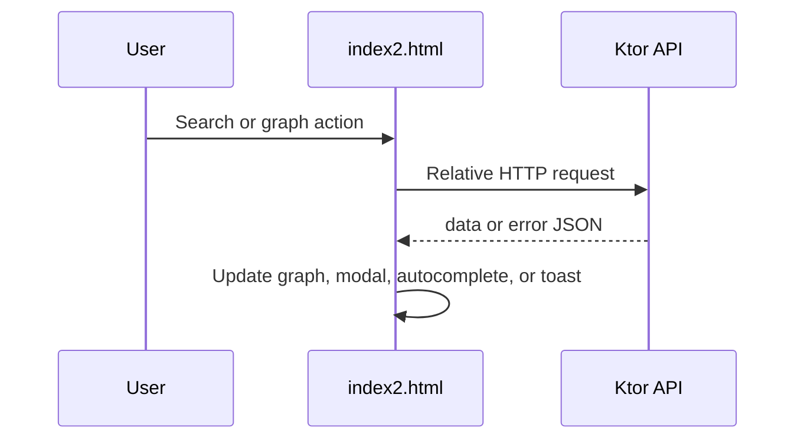

# Frontend-to-Backend Request Flows

**Scope:** The authoritative static client is `sparql/index2.html`, served by
Ktor. `API_BASE` is empty, so every request below is same-origin during local
development at `http://localhost:8080`.

Field-level request bodies and the Export Query file: [[Legacy Wire Format]]
(QUAL-010), backed by `fixtures/legacy/`.

## Request-flow matrix

| Frontend trigger/function | Request and payload mapping | Response consumption | Failure presentation | Contract and automated coverage |
|---|---|---|---|---|
| Page initialization | `GET /health` through `$.get` | Logs a warm-up success only | Console warning: `API warmup failed (offline?)` | [[03 - Backend/API v1#GET /health\|API v1]]; `ApplicationTest`; `StaticFrontendRoutesTest` |
| Turtle file chooser | `POST /api/local-database`, multipart `ttlFile` from selected file | Assigns `response.data` to `#input-endpoint-sparql`; success toast | Loading overlay ends; toast includes raw `err.responseText` or `Unknown error` | [[03 - Backend/API v1#POST /api/local-database\|API v1]]; `LocalDatabaseRoutesTest`; `StaticFrontendRoutesTest` |
| Search field after 400 ms debounce | `POST /api/query/search`: `endpointUrl: getEndpoint()`, trimmed `search`, `limit: getLimit()` | Builds Materialize autocomplete labels and stores each full item in `searches` | Console error only | [[03 - Backend/API v1#POST /api/query/search\|API v1]]; `QueryRoutesTest`; `StaticFrontendRoutesTest` |
| Select autocomplete item | Zero or more `POST /api/query` connection probes: graph IDs and `?predicate`, `limit: 1`, `ignoreWikidata: false` | If a probe returns data, adds a graph relationship; otherwise adds standalone node | Console error; probe resolves `false` | [[03 - Backend/API v1#POST /api/query\|API v1]]; `QueryRoutesTest`; `StaticFrontendRoutesTest`; browser interaction coverage is deferred to `FE-001` |
| Node action list: Explore relationships | A left-click selects an entity node; the explicit list action sends `POST /api/query/relationships` with `endpointUrl` and selected node `id` | The list remains selected while `trData` is filled, the relationship table is rendered, and the result modal opens | Loading overlay ends; generic failure toast and console error; the action list remains associated with the node | [[03 - Backend/API v1#POST /api/query/relationships\|API v1]]; `QueryRoutesTest`; `StaticFrontendRoutesTest`; `frontend-tests/index2.spec.mjs` |
| Node action list: Connect with variable predicate | No HTTP request. The action reserves a collision-safe predicate variable and shows a dashed arrow from the selected node. | Clicking another existing node adds an edge with that predicate variable; `buildFilters()` uses it in later queries. | Escape or graph-background click cancels without adding an edge. | `frontend-tests/index2.spec.mjs` |
| Node action list: Connect with defined predicate | `POST /api/query/relationships` with `endpointUrl`, source node `id`, and current `limit` | Returned predicate labels appear in the same action list; choosing one shows the arrow preview, and clicking a destination node adds the fixed-predicate edge. | Empty response says no predicates were found; request failure offers a retry action. Escape/background cancels an active preview. | [[03 - Backend/API v1#POST /api/query/relationships\|API v1]]; `frontend-tests/index2.spec.mjs` |
| Edge action list: Convert relation to variable | A left-click on an existing edge performs no HTTP request. The explicit action changes the predicate held in its `nodeId` to a collision-safe `?predicate_<number>` variable and shows `?`; source, target, edge ID, and other data stay unchanged. | The next query uses the changed predicate as part of `where`; when there is no variable node, that predicate variable becomes `variableName`. | No HTTP failure path exists for conversion. The menu closes after conversion; a background click also dismisses the list. | `frontend-tests/index2.spec.mjs`; browser coverage asserts the eventual `POST /api/query` JSON body. |
| Relationship table selection | `POST /api/query/relationship-value`: `endpointUrl`, cached `subjectId`, `predicateId`, `isLiteral` | One value creates node/edge; zero or many creates a `many-results` placeholder | Loading overlay ends; generic failure toast and console error | [[03 - Backend/API v1#POST /api/query/relationship-value\|API v1]]; `QueryRoutesTest`; `StaticFrontendRoutesTest` |
| Variable-node action list: Run query | The explicit action sends `POST /api/query`: `endpointUrl`, graph-derived `where`, selected `variableName`, `limit` | Fills `trData`, renders a result table, then selection replaces/adds graph nodes; replacement retargets the persistent action list. Each outgoing neighbour is fetched again through `relationship-value`, with `isLiteral` false for a fixed IRI node (BUG-006) and true otherwise | Loading overlay ends; generic `Query failed` toast and console error | [[03 - Backend/API v1#POST /api/query\|API v1]]; `QueryRoutesTest`; `StaticFrontendRoutesTest`; `frontend-tests/index2.spec.mjs` |
| Variable-node action list: Add value filter (FE-030, FE-034) | `POST /api/query/relationships` for the variable `id`; after a choice, `POST /api/query/numeric-profile` with `limit` 1 for the new value variable | Lists only datatype relations (`propertyType` `label`) sorted by label. Choosing one adds a value variable (`type` `value-variable`, ID `?value_<n>`, any value) fed by the variable through that relation and opens its filter editor at **Any value**, with the input seeded by the smallest numeric value (empty when none). | Empty list says no value relations were found; failure offers retry. A failed profile leaves the input empty. |
| Filter editor text suggestions (FE-038) | 400 ms after typing in Edit value or Edit filter, `POST /api/query/stage` (`textSuggestionRequest`): the node's own value variable, or `?suggestedValue` in place of a value node, under the rest of `where`, with `variableFilters` Starts with (0, when that type is chosen) or Contains (1) on the typed text, case-sensitive, `limit` 20 | Lists the distinct literal texts; choosing one fills the input and selects Exact match. Needs one fixed relation into the node; empty text sends nothing | Status line `No value starts with/contains “…”.` or `Could not load matching values: <error>`; a newer request aborts the older one | [[03 - Backend/API v1#POST /api/query/stage\|API v1]]; `VariableFilterRoutesTest`; `frontend-tests/index2.spec.mjs`; `query-calculations.unit.mjs` |
| Value-variable action list: Edit filter (FE-034) | No request until applied; the editor's histogram profiles the relation (`numeric-profile`) | Any value, Exact match, Starts with, Contains, At least, At most and Between (no MAX/MIN). Apply changes `filterType`/`filterValue`/label in place; the ID, relations and stage stay. An empty value is any value. Later requests carry it in `variableFilters` | Invalid Between/At least/At most shows a toast and keeps the old filter | [[03 - Backend/API v1#POST /api/query/numeric-profile\|API v1]]; `frontend-tests/index2.spec.mjs` |
| Run Query with one or more variables (staged panel; one variable since BUG-005) | `fetch` `POST /api/query/stage`: `endpointUrl`, `where` from `buildFilters()` captured when the panel opens, `variableFilters` of the value variables in `where` (FE-034; omitted when none), `variableName` = current stage variable in block order, typed `bindings` committed so far, `limit` = `getLimit()` capped at 50, `offset` (Load more adds the page limit) | Renders typed candidates (label or value, type hint); blank nodes are disabled; click/Enter commits the candidate and requests the next stage; hover or keyboard focus sends one delayed (300 ms) preview request for the next variable under that assumed binding, aborting any superseded preview. Pages are cached per request until the query signature changes. After the last stage, **Apply to graph** changes the graph (no request); a value's **Assume** button (FE-025) applies the committed path plus that value at once and re-runs Run Query for the remaining variables, staged even when one remains | Panel status shows loading, `No values for ?x under the chosen bindings.`, or the server `error` text with Retry; a superseded response is ignored | [[03 - Backend/API v1#POST /api/query/stage\|API v1]]; `StageQueryRoutesTest`; `StaticFrontendRoutesTest`; `frontend-tests/index2.spec.mjs` |
| Numeric profile of a filter node (BE-003; used by FE-026–FE-029) | `fetchNumericProfile(nodeId)` → `fetch` `POST /api/query/numeric-profile`: `endpointUrl`, `where` = the node's component without the relation into the node, `subject`/`predicate` of that relation (fixed IRI only), `limit` 500 | Resolves to `data` (count, min, max, truncated, values ordered by number); null when the node has no single fixed relation | Rejects with the server `error` text | [[03 - Backend/API v1#POST /api/query/numeric-profile\|API v1]]; `NumericProfileRoutesTest`; `frontend-tests/index2.spec.mjs` |
| Filter funnel panel (FE-028) | **Filter funnel** opens `#filter-funnel-panel`; `filterFunnelPlan()` derives one `fetch` `POST /api/query/count` per step: `endpointUrl`, `variableName` (first in variable order or the panel's picker), `where` with not-yet-applied fixed-value steps relaxed to `?__funnelN`; base request relaxes all steps. Steps are fixed-predicate relations to an IRI or literal; MAX/MIN steps (BE-004, every tie kept) come after the other steps so the last count is the query's result; at most 8 counted. Requests run one at a time, are cached by body, and refresh 350 ms after graph/endpoint edits | Rows show the base count, the remaining count after each enabled step and the drop; unticking a step is preview-only (its row repeats the previous count, later counts change); Run Query and View SPARQL still send every filter | Panel status shows `Counting…` or `Could not count results: <error>` with Retry; a superseded refresh is aborted and ignored | [[03 - Backend/API v1#POST /api/query/count\|API v1]]; `ResultCountRoutesTest`; `StaticFrontendRoutesTest`; `frontend-tests/index2.spec.mjs`; `query-calculations.unit.mjs` |
| Filter badges over the graph (FE-036) | 400 ms after graph/endpoint edits, `filter-badges.js` sends `POST /api/query/numeric-profile` (`numericProfileRequest`) for each filtered value node under a variable, or `POST /api/query/relationship-value` (`endpointUrl`, `subjectId`, `predicateId`, `isLiteral: true`) once its subject is a fixed entity; responses are cached by body (failures are not) | `kept / total` badge (`+` lower bound, amber partial, red at 0) or the entity's actual values under the node with a ✓/✗ badge for the kept filter; node data and sent filters are unchanged | `?` badge with the error; empty or failed value lookup shows `value unknown`; superseded responses are ignored | `StaticFrontendRoutesTest`; `frontend-tests/index2.spec.mjs`; `query-calculations.unit.mjs` |
| SPARQL preview | `POST /api/query/sparql`: `endpointUrl`, graph-derived `where`, `variableName`, `limit` | Writes `data.data` using `.text()` and opens SPARQL modal | Loading overlay ends; substitutes generic modal text, logs error, opens modal | [[03 - Backend/API v1#POST /api/query/sparql\|API v1]]; `QueryRoutesTest`; `StaticFrontendRoutesTest` |

`getEndpoint()` trims the endpoint input. `getLimit()` accepts a positive
integer and otherwise sends `20`. `buildFilters()` maps graph edges to
`{subject, predicate, object, filterType}`; it preserves numeric `filterType:
0`, the valid “Starts with” value.

FE-034: a value variable (`type` `value-variable`) is a variable node, so its
relation goes into `where` with `filterType: null`. Its filter goes into
`variableFilters` (`{variableName, filterType, value}`, from
`variableFilterItems()`). Every request with `where` gets it: the Run query
action, staged Run Query, View SPARQL, the funnel counts, profiles and badges.
Each request carries only the filters of the variables that are objects in its
own `where`, so a profile of the value variable leaves out the variable's own
filter. The field is omitted when it would be empty, so graphs without a value
variable send the same requests as before. Assume and Apply settle a value
variable through `bindVariable` (FE-033) into a plain value node without the
filter. The legacy node **Run query** table cannot list literals (BUG-005), so
a value variable does not offer that action.

## Node action-list flow

Predicate-query result selection uses `replacePredicateVariable`, with edge
IDs captured when `getQuery` starts. It changes the existing edge's predicate
identifier/label and clears its variable type without adding nodes, rewiring,
or requesting relationship values. Removed or rebound edges are ignored.
Since BUG-005 the main Run Query stages a single predicate variable, so this
legacy path is no longer reached from the UI; it is kept and tested through
`getQuery`.
The result table still routes ordinary node bindings to `replaceNodeVariable`
and default-node exploration to `getRelationshipValue`.

*Implemented (BUG-003):* `replaceNodeVariable` (`replaceWithNewNode`) reuses
an existing node when the chosen value is already in the graph (typical in
cycles) and moves the variable's edges to it with their IDs and data. Each
other outgoing target is still removed and replaced through
`/api/query/relationship-value`; an edge that becomes a loop on the chosen
node is kept and sends no request. `addNodeWithRelationship` reuses an
existing node and gives its edge the first free ID (`<predicate><index>_<n>`)
instead of throwing on a duplicate.

Before staging or execution, the main Run Query action rejects two or more
distinct predicate variables between the same fixed subject/object values.
It shows a message without modifying the graph or sending an API request.
Successive edges with exactly two variables retain their staged-panel flow;
parallel edges sharing one predicate variable are one stage (BUG-005).

**Confirmed:** Node and edge selection themselves send no request and perform
no node-type operation. A node opens its semantic vertical list beside the node;
an edge opens a separate list beside its rendered midpoint. Selecting one closes
the other, so an edge cannot run a node action. Node actions then invoke the
same functions used by the earlier direct-tap behavior:
relationship exploration, variable/default query execution, safe link opening,
Boolean toggling, literal editing, conversion, and removal. The list is
retargeted when an action replaces the selected node. A true Cytoscape
background click is the normal dismissal path; Remove also closes it because
there is no longer a target. Pan, zoom, resize, layout, and node-position events
reposition the lists, which become visually hidden while their target is outside
the graph viewport.

## Confirmed error-behavior gap

**Confirmed:** Most client request callbacks discard the approved Kotlin JSON
`error` field and show generic English text or merely log the failure. Turtle
upload is the exception: it displays raw `responseText`. This preserves the
current behavior, but means client users usually cannot see the diagnostic
documented in [[03 - Backend/API v1]]. Whether to render parsed, safe error
diagnostics consistently is a future UX decision; this task makes no contract
or UI change.

## Coverage boundary

`StaticFrontendRoutesTest` confirms Ktor serves the authoritative client and
that its source declares each backend route, same-origin base, and `ttlFile`
form field. `ApplicationTest`, `LocalDatabaseRoutesTest`, and
`QueryRoutesTest` exercise the corresponding HTTP contracts without live
Wikidata. `frontend-tests/index2.spec.mjs` now runs the actual page in
Playwright Firefox with test-local API responses and controlled CDN stubs. It
catches a broken autocomplete callback and verifies upload, relationship,
SPARQL-preview, query-execution, real left-click node-menu opening, retargeting,
keyboard action activation, background dismissal, the node-type action matrix,
conversion/removal, edge rewiring, viewport positioning, edge-menu isolation,
predicate-variable conversion, and the exact `POST /api/query/stage`
predicate-query payload. Staged exploration is covered with routed stage responses and, end
to end against Ktor and a local Turtle fixture, by `npm run test:e2e`.

## Source files

- `sparql/index2.html`
- `frontend-tests/index2.spec.mjs`
- `frontend-tests/cdn-stubs.mjs`
- `src/test/kotlin/com/example/sparqlqueryeasy/http/StaticFrontendRoutesTest.kt`
- `src/test/kotlin/com/example/sparqlqueryeasy/http/QueryRoutesTest.kt`
- `src/test/kotlin/com/example/sparqlqueryeasy/http/LocalDatabaseRoutesTest.kt`
- `src/test/kotlin/com/example/sparqlqueryeasy/ApplicationTest.kt`
- [[03 - Backend/API v1]]
