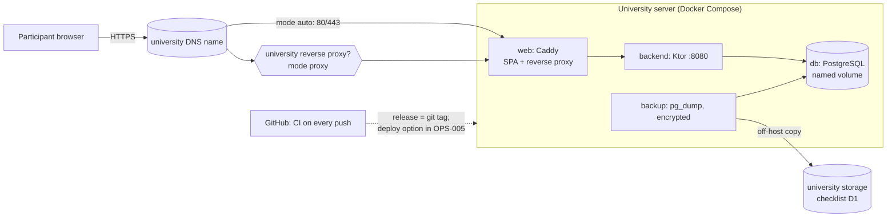

# Deployment Roadmap — from the local app to real users

Created 2026-10-07 (DOC-003) from the user's goal: deploy SPARQL EasyQuery so
real people can test it, with a proper name and HTTPS, PostgreSQL holding the
login passwords and study data, and releases from GitHub. Since DEC-003 the
target is the user's university server. The
user wants to **do most of it by hand to learn**, so every step below has a
learning task (`LEARN-*`) that teaches it in depth, including how to verify
each piece yourself from the command line.

Progress is tracked in [[Deployment Learning Tracker]].

> **2026-10-27:** rewritten for the university server (DEC-003). The first
> version (2026-10-07) targeted AWS (EC2, RDS, ECR, Route 53); it is kept
> only in git history. LEARN-003…014 were rewritten the same day.

## What exists today (evidence)

- A Docker Compose project: `db` (PostgreSQL 17), `backend` (Ktor/JVM,
  API + SPA), `web` (Caddy, the only service on the network) and `backup`
  (encrypted scheduled dumps). See [[../Docker Compose Stack]].
- Accounts with Argon2id passwords and server sessions, admin role by
  `EASYQUERY_ADMIN_USERNAMES`, the study (consent, tasks, questionnaires,
  CSV export), Flyway migrations.
- HTTPS by Caddy certificates (`auto`) or behind a university proxy
  (`proxy`), one setting (OPS-008); logs and resource limits (OPS-010).
- A server runbook: install, update, roll back, restore, rotate secrets
  ([[../Server Deploy Runbook]], OPS-011, REVIEW).
- CI on GitHub runs every gate; there is no automatic deploy.
- Open: the university's answers ([[../University Server Checklist]]):
  reachability, ports/proxy, DNS name, deploy access, off-host backups.

## Target architecture

| Piece | Choice | Why |
|---|---|---|
| Compute | The university server running Docker Compose (DEC-003) | Free for the study, close to participants, IT support |
| TLS / proxy | Caddy: own certificates (`auto`) or behind the university proxy (`proxy`) | One setting covers both answers IT may give |
| Database | PostgreSQL in the `db` container with a named volume | Same stack locally and on the server |
| Images | Built on the server from a git tag (DEC-017 Q5) | No registry account needed |
| Deploy | Runbook by hand now; automation chosen in OPS-005 after checklist A4 | The university may not allow inbound access from GitHub |
| Secrets | `.env` on the server, owner-only, never in Git/images | Simple, auditable, rotation in the runbook |
| Observability | Container logs with rotation, external uptime check, off-host backups | Notice failures during sessions; survive losing the server |

## The steps, in order

Do the learning task first, then the real step (milestones M1–M14 in the
[[Deployment Learning Tracker]]).

### Phase 0 — Foundations

1. **Linux, shell and networking.** → `LEARN-001`.
2. **Containers.** → `LEARN-002`.

### Phase 1 — The server

3. **Access and hardening:** SSH keys, privileges, updates, clock. → `LEARN-003`.
4. **Network:** listening ports, firewall, proxies, reachability, outbound
   access; choose the HTTPS mode. → `LEARN-004`.

### Phase 2 — Run the app by hand

5. **Compose stack on the server** following the runbook. → `LEARN-005`.
6. **Releases:** tags, image builds on the server, update and roll back.
   → `LEARN-006`.

### Phase 3 — Data, login and secrets

7. **PostgreSQL in the stack:** `psql`, schema, roles, restore drill.
   → `LEARN-007`.
8. **Passwords and sessions done right.** → `LEARN-008`.
9. **Configuration and secrets** on the server, rotation. → `LEARN-009`.

### Phase 4 — Name and HTTPS

10. **The app's university DNS name.** → `LEARN-010` (OPS-002).
11. **HTTPS and reverse proxy** in the chosen mode. → `LEARN-011` (OPS-008).

### Phase 5 — CI/CD

12. **GitHub Actions and a safe deploy path** to the server. → `LEARN-012`
    (OPS-005).

### Phase 6 — Operate it while people test

13. **Logs, uptime alerts, off-host backups, runbooks.** → `LEARN-013`
    (OPS-004).
14. **Go-live checklist** (security suite QUAL-019…023, consent/LGPD,
    dress rehearsal, end-of-test plan). → `LEARN-014`.

## Decisions you will need to make along the way

| Decision | Where it is decided | Learn first |
|---|---|---|
| HTTPS mode (`auto` or `proxy`) | `OPS-008` / checklist N2, H2, H3 | `LEARN-004`, `LEARN-011` |
| The app's DNS name | `OPS-002` / checklist H1 | `LEARN-010` |
| Deploy method, approval and rollback | `OPS-005` / checklist A4 | `LEARN-012` |
| Alerting, backup location, RPO/RTO | `OPS-004` / checklist D1, O1, O2 | `LEARN-013` |
| Upload limit (remote endpoints: allowlist, decided) | `QUAL-021` | `LEARN-014` |

The roadmap is a plan, not an approval: nothing is installed on the
university server or deployed by this document.

## Source files

- `Dockerfile`, `src/main/resources/application.conf`
- [[../Local JVM and Container Runtime]], [[../Operations Inventory]]
- `tcc/90 - Tasks/items/OPS-002-dns-tls-cors.md` … `OPS-005-design-kotlin-deployment-workflow.md`
- `tcc/90 - Tasks/items/AUTH-000-authentication-contract-decision.md`
