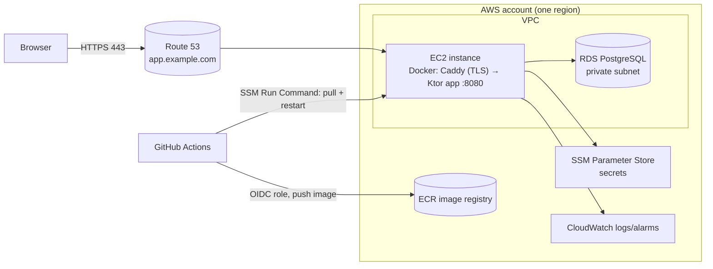

# Deployment Roadmap — from the local app to real users

Created 2026-10-07 (DOC-003) from the user's goal: deploy SPARQL EasyQuery so
real people can test it, with the backend on AWS, continuous deployment from
GitHub, a proper domain/DNS, and PostgreSQL holding the login passwords. The
user wants to **do most of it by hand to learn**, so every step below has a
learning task (`LEARN-*`) that teaches it in depth, including how to verify
each piece yourself from the command line.

Progress is tracked in [[Deployment Learning Tracker]].

> **2026-10-16, DEC-003:** production will run with Docker Compose on the
> user's university server, not AWS. AWS-specific steps below are history;
> see [[../../90 - Tasks/items/DEC-003-production-hosting-target]] and OPS-006.

## What exists today (evidence)

- One Kotlin/Ktor JVM process (Java 21) serving the API **and** the static
  frontend on port `8080`; `GET /health` returns `{"status":"ok"}`.
  See [[../Local JVM and Container Runtime]].
- A local-only `Dockerfile` (multi-stage, non-root user `10001`, health check).
- No database, no authentication, no active GitHub Actions workflow, no
  cloud resources, no domain. See [[../Operations Inventory]].
- Built-in RDF graphs are bundled in the image; uploaded graphs live only in
  memory and are lost on restart.
- Open product/security decisions that deployment depends on: `AUTH-000`
  (login contract), `SEC-001` (endpoint/upload limits), `OPS-002`–`OPS-005`.

## Target architecture (recommended first version)

Chosen for **learning by hand, low cost and a small user test**, not for
high availability. Each choice is revisited in the learning task named.

| Piece | First version | Why | Later option |
|---|---|---|---|
| Compute | One EC2 instance running Docker | You see and control everything (Linux, Docker, ports, logs) | ECS Fargate + load balancer |
| TLS / reverse proxy | Caddy container with automatic Let's Encrypt | Teaches HTTPS with one small config file | ALB + ACM certificate |
| Database | RDS for PostgreSQL, smallest class, private | Managed backups/patching; still learn `psql`, roles, networking | PostgreSQL in Docker (learning lab only) |
| Image registry | Amazon ECR | Same account/IAM as the server | GitHub Container Registry |
| CI/CD | GitHub Actions: test → build → push → deploy via SSM | No SSH keys or long-lived AWS keys in GitHub (OIDC) | Blue/green or ECS rolling deploys |
| DNS | Route 53 hosted zone; domain from any registrar (e.g. Registro.br for `.br`) | Learn delegation, records, TTL, `dig` | — |
| Secrets | SSM Parameter Store `SecureString` | Free tier for standard parameters, IAM-controlled | Secrets Manager with rotation |
| Observability | Docker logs → CloudWatch Logs, health alarm, billing alarm | Know when it breaks and what it costs | Metrics/tracing |

**Costs:** EC2, RDS, public IPv4 addresses, Route 53 hosted zones and domains
are paid (some may be covered by AWS free-tier credits for new accounts —
check the current AWS pricing pages before creating anything). `LEARN-003`
sets a budget alarm **before** any resource exists.

## The steps, in order

Each phase lists what you will do, the existing project task it unblocks, and
the learning task. Do the learning task first, then the real step.

### Phase 0 — Foundations (no cloud yet, no cost)

1. **Linux, shell and networking basics.** Processes, ports, `ss`, `curl`,
   `dig`, `journalctl`, SSH, file permissions; IP, TCP, HTTP, DNS and TLS at
   the level needed to debug a web app. → `LEARN-001`.
2. **Containers.** Build and run the existing image locally, inspect it,
   understand layers, users, ports, health checks, environment variables,
   volumes and image tags/digests. → `LEARN-002`.

### Phase 1 — AWS account done safely

3. **AWS account, security and cost guardrails.** Root user with MFA and then
   left alone; IAM Identity Center (or an IAM admin user) with MFA; AWS CLI
   profiles; region choice (`sa-east-1` São Paulo vs. cheaper `us-east-1`);
   budget and billing alarms; tagging. → `LEARN-003`.
4. **Network.** VPC, public/private subnets, route tables, internet gateway,
   security groups as firewalls, public IPv4 cost, Session Manager instead of
   open SSH. → `LEARN-004`.

### Phase 2 — Run the app on a server by hand

5. **EC2 server.** Launch an instance with an IAM role, connect through
   Session Manager, install Docker, run the image from ECR, map ports, restart
   policy, see logs, reboot and confirm it comes back. → `LEARN-005`
   (unblocks `OPS-003`).
6. **Image registry.** Create an ECR repository, push a tagged image from
   your machine, pull it on EC2, lifecycle policy for old images, immutable
   tags. → `LEARN-006`.

### Phase 3 — Data and login

7. **PostgreSQL.** Concepts (databases, schemas, roles, privileges), `psql`,
   a local PostgreSQL in Docker first, then RDS in a private subnet reachable
   only from the EC2 security group; TLS to the database; backups and a
   restore drill; migrations (e.g. Flyway). → `LEARN-007`.
8. **Passwords and sessions done right.** Why passwords are hashed (Argon2id or
   bcrypt), never encrypted or stored plain; salts; session cookies
   (`HttpOnly`, `Secure`, `SameSite`); CSRF; rate limiting login attempts.
   This is the knowledge needed to approve `AUTH-000` and review `AUTH-001`.
   → `LEARN-008`.
9. **Configuration and secrets.** Environment-based config for Ktor, SSM
   Parameter Store `SecureString`, IAM permission to read only the app's
   parameters, never committing secrets, rotating the DB password.
   → `LEARN-009`.

### Phase 4 — Domain, DNS and HTTPS

10. **Domain and DNS.** Buy/own a domain, create a Route 53 hosted zone,
    delegate the registrar's NS records, A/AAAA/CNAME/alias records, TTL and
    caching, verify with `dig +trace`. → `LEARN-010` (unblocks `OPS-002`).
11. **HTTPS and reverse proxy.** Caddy in front of Ktor on the same Docker
    network, automatic Let's Encrypt certificates, HTTP→HTTPS redirect,
    forwarded headers, security headers; verify with `curl -v` and
    `openssl s_client`. → `LEARN-011` (with `OPS-002`).

### Phase 5 — Continuous deployment from GitHub

12. **GitHub Actions CI/CD.** Workflow anatomy, a CI job running the existing
    gates, OIDC trust between GitHub and an AWS IAM role (no stored AWS keys),
    build and push to ECR tagged by commit SHA, deploy with SSM Run Command,
    health-check after deploy, manual approval with GitHub Environments,
    rollback to the previous tag. → `LEARN-012` (unblocks `OPS-005`).

### Phase 6 — Operate it while people test

13. **Observability, backups and incident basics.** Logs in CloudWatch, a
    health-check alarm, disk/memory checks, RDS automated backups and a
    tested restore, a short runbook ("site is down", "deploy broke", "DB
    full"). → `LEARN-013` (unblocks `OPS-004`).
14. **Go-live checklist for user testing.** Security review (`SEC-001`
    limits on uploads/remote endpoints), privacy notice and data handling for
    participants (LGPD if participants are in Brazil), test accounts,
    shutdown/cost plan after the test. → `LEARN-014`.

## Decisions you will need to make along the way

| Decision | Where it is decided | Learn first |
|---|---|---|
| Login contract: who are the users, anonymous access, protected routes | `AUTH-000` | `LEARN-008` |
| AWS region and monthly budget | `OPS-003` | `LEARN-003` |
| Domain name and registrar | `OPS-002` | `LEARN-010` |
| Hosting shape (EC2 first vs. ECS) | `OPS-003` | `LEARN-005` |
| Release method, approval and rollback | `OPS-005` | `LEARN-012` |
| Logs retention, alarms, backup/restore objectives | `OPS-004` | `LEARN-013` |
| Upload/remote-endpoint limits for public users | `SEC-001` | `LEARN-014` |

The roadmap is a plan, not an approval: no AWS resource, domain purchase or
workflow is created by this document.

## Source files

- `Dockerfile`, `src/main/resources/application.conf`
- [[../Local JVM and Container Runtime]], [[../Operations Inventory]]
- `tcc/90 - Tasks/items/OPS-002-dns-tls-cors.md` … `OPS-005-design-kotlin-deployment-workflow.md`
- `tcc/90 - Tasks/items/AUTH-000-authentication-contract-decision.md`
