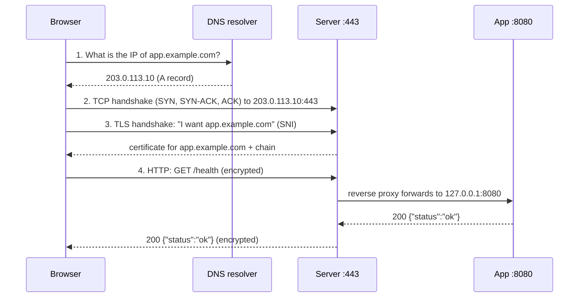
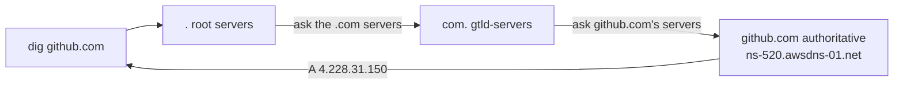

# L01 — Linux Shell and Networking for Debugging a Web App

Lesson for [[../../90 - Tasks/items/LEARN-001-linux-shell-networking|LEARN-001]].
Progress: [[Deployment Learning Tracker#L01 - Linux Shell and Networking]].
Roadmap: [[00 - Deployment Roadmap]].

> [!info] How to read this lesson
> Every command output in this lesson was **observed** on the development
> machine on 2026-10-07 (Fedora, Java 21, the app built from `main`), unless
> it is marked *expected*. Your numbers (PIDs, IPs, timings) will differ;
> the shape will not. Type the commands yourself — reading them is not the
> same as running them.

## 1. Why this comes first

When the app is on a server and "it does not work", the browser tells you
almost nothing. The question is always *which layer failed*:

| What you see in the browser | What may actually be wrong | Layer |
|---|---|---|
| "This site can't be reached — DNS_PROBE_FINISHED_NXDOMAIN" | the name does not resolve | DNS |
| spins for a long time, then "took too long to respond" | a firewall drops packets, wrong IP | network |
| "refused to connect" | the machine is reachable but nothing listens on that port | TCP / process |
| "Your connection is not private" | certificate expired, wrong name, not trusted | TLS |
| 404 / 500 / 502 page | the request arrived; the app or proxy answered with an error | HTTP / app |

By the end of this lesson you can tell these apart **from a terminal** in a
couple of minutes. Every later module (Docker, EC2, DNS, HTTPS, PostgreSQL)
reuses these tools.

## 2. The journey of one request

What happens when someone opens `https://app.example.com/health`:



Four layers, four groups of tools:

| Step | Question | Tool |
|---|---|---|
| 1. DNS | Does the name resolve, and to which address? | `dig` |
| 2. TCP | Can I open a connection to that address and port? Who listens? | `nc`, `ss`, `curl` |
| 3. TLS | Which certificate is served, for which names, valid until when? | `openssl s_client`, `curl -v` |
| 4. HTTP | What does the app answer: status, headers, body, time? | `curl` |

Locally there is no DNS or TLS step: you talk HTTP directly to
`127.0.0.1:8080`. We start there and add the layers back.

## 3. Shell essentials you will use every day

You do not need to master Bash. You need these habits:

- `command --help` and `man command` before searching the web.
- Pipes: `cmd1 | cmd2` sends the output of one command into the next
  (`ss -ltnp | grep 8080`).
- Exit codes: every command returns a number; `0` means success. `echo $?`
  shows the last one. Scripts and CI rely on this: `curl --fail` returns
  non-zero on HTTP errors, which makes a deploy step fail.
- Environment variables: `export JAVA_OPTS="-Xmx512m"`, then `env | grep JAVA`.
  The app's launcher reads `JAVA_OPTS`; later the server passes secrets this
  way (LEARN-009).
- Quoting: single quotes keep text literal (`'%{http_code}'`), double quotes
  expand variables (`"$HOME"`).
- History hygiene: a command typed with a password stays in
  `~/.bash_history`. Use `read -rs VAR` to type secrets (LEARN-009).

### Processes and signals

A running program is a **process** with a PID, an owner and an exit code.

| Signal | Sent by | Meaning |
|---|---|---|
| `SIGTERM` (15) | `kill <pid>`, `docker stop`, `systemctl stop` | "please finish and exit" — the app can close connections cleanly |
| `SIGINT` (2) | Ctrl+C | interrupt from the terminal |
| `SIGKILL` (9) | `kill -9 <pid>`, Docker after a timeout, the kernel's out-of-memory killer | immediate death, no cleanup |

Use `kill` (TERM) first; `kill -9` only when a process ignores it.

### Users and permissions

```text
-rw-r----- 1 root easyquery 312 Oct  7 10:00 app.env
 │└┬┘└┬┘└┬┘     │     │
 │ │  │  └ others: no access
 │ │  └ group "easyquery": read
 │ └ owner "root": read + write
 └ "-" regular file ("d" = directory)
```

Octal shorthand: `r=4, w=2, x=1`, so `rw-r-----` is `640` and `rw-------`
is `600` (the mode for a file with secrets). `chmod 600 file`,
`chown root:root file`. The app's container runs as user `10001`, not root:
if the app is compromised, the attacker is not root inside the container.

### Services and logs (systemd)

On the server, long-running programs such as Docker are **services** managed
by systemd:

```sh
systemctl status docker          # running? since when? last log lines
sudo systemctl restart docker
systemctl is-enabled docker      # starts at boot?
journalctl -u docker --since "10 min ago"     # logs of one service
journalctl --since "15 min ago" -p warning    # warnings from everything
journalctl -f                                  # follow live
```

### Disk and memory

The two silent killers of small servers:

```sh
df -h /       # disk: when "Use%" reaches 100%, databases and Docker break
free -h       # memory: watch "available", not "free"
```

Observed on the dev machine:

```text
/dev/sda3       236G  170G   64G  73% /
               total        used        free      shared  buff/cache   available
Mem:           7,6Gi       6,8Gi       149Mi       334Mi       1,3Gi       891Mi
```

"free" is only 149 MiB, but 891 MiB is **available**: Linux uses spare memory
as disk cache and gives it back on demand. A small cloud server with 1–2 GiB
of RAM and a JVM is a tight fit; LEARN-002 and LEARN-005 come back to this.

## 4. Lab part A — the app as a process

Build and start the app from the repository root (JDK 21 required):

```sh
GRADLE_USER_HOME=/tmp/sparql-query-easy-gradle ./gradlew installDist --no-daemon
./build/install/sparql-query-easy-kotlin/bin/sparql-query-easy-kotlin
```

Observed output:

```text
SLF4J(W): No SLF4J providers were found.
SLF4J(W): Defaulting to no-operation (NOP) logger implementation
SLF4J(W): See https://www.slf4j.org/codes.html#noProviders for further details.
```

> [!warning] Finding: the app currently writes no logs
> Ktor logs through SLF4J, and no SLF4J implementation (such as Logback) is
> on the classpath, so every log line is thrown away. Locally that is only
> inconvenient; on a server it means `docker logs` and CloudWatch will show
> nothing when something fails. This is recorded for the observability
> module (LEARN-013 / OPS-004): adding a logging backend is a prerequisite
> for a useful deployment.

The terminal is now occupied by the server. Open a **second terminal**.

### Who is listening?

```sh
ss -ltnp
```

`-l` listening sockets, `-t` TCP, `-n` numbers instead of names, `-p` the
process. Observed (filtered with `| grep -E "State|8080"`):

```text
State  Recv-Q Send-Q Local Address:Port  Peer Address:PortProcess
LISTEN 0      4096               *:8080             *:*    users:(("java",pid=114001,fd=134))
```

Read it as: a `java` process with PID 114001 listens on port 8080 on **all**
addresses (`*`). Listening on all addresses means that other machines on
the network can reach it too. The opposite is `127.0.0.1:8080`, which only
the same machine can reach. Remember this distinction; Docker port
publishing in LEARN-002 is the same idea.

### What is that process?

```sh
ps -o pid,user,rss,etime,cmd -C java
```

```text
    PID USER       RSS     ELAPSED CMD
 114001 bender   204324      00:25 /home/bender/.sdkman/candidates/java/current/bin/java -classpath /home/…/build/install…
```

`RSS` is resident memory in KiB: about 200 MiB right after start, with no
load. `ELAPSED` is uptime. On a server you would also check `USER`: it
should never be `root` for the app.

### Two programs, one port

Start a second copy of the app while the first is running:

```text
Exception in thread "main" java.net.BindException: Endereço já em uso
	at java.base/sun.nio.ch.Net.bind0(Native Method)
	…
```

("Endereço já em uso" is the Portuguese system locale for *Address already
in use*.) Only one process can listen on a given address and port. Run
`ss -ltnp | grep 8080` to see which process already has it. You will meet
this again when an old container still holds a port during a deploy.

### Stopping it gracefully

```sh
kill -TERM 114001        # use your PID
sleep 3; ps -p 114001 >/dev/null && echo still running || echo stopped
ss -ltn | grep 8080 || echo "port 8080 free"
```

```text
stopped
port 8080 free
```

Start it again for the next part.

## 5. Lab part B — HTTP by hand

### curl, verbosely

```sh
curl -v http://127.0.0.1:8080/health
```

Observed (progress meter removed):

```text
*   Trying 127.0.0.1:8080...
* Established connection to 127.0.0.1 (127.0.0.1 port 8080) from 127.0.0.1 port 44198
* using HTTP/1.x
> GET /health HTTP/1.1
> Host: 127.0.0.1:8080
> User-Agent: curl/8.18.0
> Accept: */*
>
* Request completely sent off
< HTTP/1.1 200 OK
< Content-Length: 15
< Content-Type: application/json
<
* Connection #0 to host 127.0.0.1:8080 left intact
{"status":"ok"}
```

How to read `-v` output:

- `*` lines are curl talking to you: connection attempts, TLS details, reuse.
- `>` lines are what **you sent**: the request line `GET /health HTTP/1.1`
  and headers. `Host` tells the server which site you want; one server can
  host many names, and the reverse proxy in LEARN-011 depends on this.
- `<` lines are what the **server answered**: the status line, then headers.
- Then the body.

### It is only text

HTTP/1.1 is plain text over a TCP connection. You can send it yourself with
`nc` (netcat):

```sh
{ printf 'GET /health HTTP/1.1\r\nHost: localhost\r\nConnection: close\r\n\r\n'; sleep 1; } | nc 127.0.0.1 8080
```

```text
HTTP/1.1 200 OK
Content-Length: 15
Content-Type: application/json
Connection: close

{"status":"ok"}
```

> [!tip] Why the `sleep 1`?
> Fedora's `nc` is `ncat` (from nmap). It closes the connection as soon as
> its input ends, before the reply arrives, so without the pause you see
> nothing. Other `nc` variants behave differently. Knowing that your *tool*
> can be the problem is a debugging skill in itself.

Each line ends with `\r\n` and an empty line ends the headers. That is the
entire protocol for a simple request. After HTTPS is added (LEARN-011), the
same text travels inside an encrypted TLS tunnel.

### Status codes you will see from this app

```sh
curl -sS -o /dev/null -w '%{http_code}\n' http://127.0.0.1:8080/nope
curl -sS -w ' -> %{http_code}\n' -H 'Content-Type: application/json' -d '{"where":[]}' http://127.0.0.1:8080/api/query
curl -sS -D - -o /dev/null http://127.0.0.1:8080/
curl -sSI http://127.0.0.1:8080/
```

Observed:

```text
404
{"error":"Missing required field: variableName"} -> 400
HTTP/1.1 302 Found
Location: /index2.html
Content-Length: 0
HTTP/1.1 405 Method Not Allowed
```

| Code | Meaning | Here |
|---|---|---|
| 2xx | success | `200` from `/health` |
| 3xx | go elsewhere (`Location` header) | `302` from `/` to `/index2.html` |
| 4xx | **your** request is wrong | `404` unknown path, `400` invalid JSON body, `405` wrong method |
| 5xx | the **server side** failed | `500` app bug, `502` the app's upstream (e.g. Wikidata) or a proxy's upstream failed, `503`/`504` unavailable or timed out |

Look at the last two lines: `curl -I` sends a `HEAD` request, the root route
only answers `GET`, so it returns **405** while a `GET` gets a **302**.
Health checks, uptime monitors and load balancers sometimes use `HEAD`, so
"it works in the browser but the monitor says it is down" can be exactly
this. When you set up monitoring in LEARN-013, check which method it uses.

### Timing

```sh
curl -sS -o /dev/null -w '%{http_code} connect=%{time_connect}s total=%{time_total}s\n' http://127.0.0.1:8080/index2.html
```

```text
200 connect=0.000156s total=0.158758s
```

The connection took 0.16 ms and the whole response 159 ms. On the internet
`time_connect` grows with the distance to the server. Add
`dns=%{time_namelookup}s tls=%{time_appconnect}s` once DNS and TLS are
involved, and you can tell *where* time is spent.

## 6. Lab part C — the three classic failures

Learn to recognize these three errors on sight:

```sh
curl -sS http://127.0.0.1:8081/                          # nothing listens
curl -sS --connect-timeout 3 http://10.255.255.1/         # nobody answers
curl -sS http://no-such-host.invalid/                     # name does not exist
```

Observed:

```text
curl: (7) Failed to connect to 127.0.0.1 port 8081 after 0 ms: Could not connect to server
curl: (28) Connection timed out after 3002 milliseconds
curl: (6) Could not resolve host: no-such-host.invalid
```

| Error | What happened on the wire | Typical cause on a server |
|---|---|---|
| **(7) refused**, instantly | the machine answered "nothing listens on this port" (TCP RST) | app not running, wrong port, app bound to `127.0.0.1` while you connect from outside |
| **(28) timeout**, after seconds | no answer at all — packets dropped | firewall/security group blocks the port, wrong IP, instance stopped, no route |
| **(6) could not resolve** | DNS has no answer for the name | typo, record not created yet, delegation broken, cached old answer |

The **speed** of the failure is the clue. "Refused" is a fast and
definite answer, while a timeout means silence. In AWS a timeout almost
always means a security group or route table problem (LEARN-004).

## 7. Addresses, ports and routes

```sh
ip -brief addr
ip route
```

Observed (dev machine on home Wi-Fi):

```text
lo               UNKNOWN        127.0.0.1/8 ::1/128
wlp2s0           UP             192.168.0.178/24 2804:5d80:…/64 fe80::…/64
default via 192.168.0.1 dev wlp2s0 proto dhcp src 192.168.0.178 metric 600
192.168.0.0/24 dev wlp2s0 proto kernel scope link src 192.168.0.178 metric 600
```

- `lo` is the **loopback**: `127.0.0.1` always means "this machine".
- `wlp2s0` has a **private** IPv4 address `192.168.0.178`. Private ranges
  are `10.0.0.0/8`, `172.16.0.0/12` and `192.168.0.0/16`; they are not
  reachable from the internet. Your AWS VPC (LEARN-004) will use `10.0.0.0/16`.
- **CIDR**: `/24` means the first 24 of 32 bits are the network, so
  `192.168.0.0/24` covers `192.168.0.0`–`192.168.0.255` (256 addresses).
  A `/16` covers 65,536 addresses.
- `default via 192.168.0.1` is the **default route**: anything not on the
  local network goes to the home router. In AWS, a subnet is "public" exactly
  when its route table has a default route to an internet gateway.
- The address starting with `2804:` is a public **IPv6** address, and `fe80::` is
  link-local. IPv6 is an option on AWS, but this path uses IPv4 first.

**Ports**: one IP has 65,535 TCP ports. Ports below 1024 are privileged
(only root binds them by default), which is one reason the app uses 8080 and
a proxy listens on 80/443.

**`0.0.0.0` vs `127.0.0.1` when listening**: `0.0.0.0` (or `*`) means "all
my addresses", so other machines can connect. `127.0.0.1` means "only from this
machine". On the server, the app will listen only internally and Caddy will
be the only public listener.

## 8. DNS: names to addresses

```sh
dig github.com A +short
```

```text
4.228.31.150
```

That is the answer your local **resolver** gave you. Behind it is a
chain of delegations, which `+trace` walks without using any cache:

```sh
dig +trace github.com
```

Observed (abridged to one line per step):

```text
.           NS  c.root-servers.net.          ;; Received … from 127.0.0.53#53 (local resolver: the root list)
com.        NS  l.gtld-servers.net.          ;; Received … from e.root-servers.net        in 2 ms
github.com. NS  ns-520.awsdns-01.net.        ;; Received … from h.gtld-servers.net        in 140 ms
github.com. A   4.228.31.150                 ;; Received … from ns-520.awsdns-01.net      in 11 ms
```



- The **root** servers know who runs each top-level domain.
- The **TLD** servers (`.com`, `.br`) know which nameservers are
  **authoritative** for each domain. That is the "delegation" you set at
  your registrar.
- The **authoritative** servers hold the actual records.

Notice `awsdns` in the third step: GitHub's DNS is hosted on **Amazon
Route 53**, the same service you will use in LEARN-010. Your own domain will
show four `awsdns` servers at that step once you delegate it.

Normally your computer does not walk this chain itself. A **recursive
resolver** (your router, your ISP, `1.1.1.1`, `8.8.8.8`, or `127.0.0.53` which
is systemd-resolved locally) does it for you and **caches** the answers for
their TTL. That caching is why DNS changes "take time to propagate"
(LEARN-010).

## 9. TLS: who is on the other side?

```sh
openssl s_client -connect github.com:443 -servername github.com </dev/null 2>/dev/null \
  | openssl x509 -noout -subject -issuer -dates -ext subjectAltName
```

Observed:

```text
subject=CN=github.com
issuer=C=GB, O=Sectigo Limited, CN=Sectigo Public Server Authentication CA DV E36
notBefore=Sep  1 00:00:00 2026 GMT
notAfter=Nov 29 23:59:59 2026 GMT
X509v3 Subject Alternative Name:
    DNS:github.com, DNS:www.github.com
```

- `-servername` sends **SNI**, which tells the server which name you want, because
  one IP can serve many certificates. Forgetting it is a classic cause of
  "wrong certificate" when testing by hand.
- **Subject Alternative Name** lists the names the certificate is valid for.
  The browser checks that the name in the address bar is in this list.
- **Issuer** is the certificate authority (CA) that vouched for it. Browsers
  trust a set of root CAs, and the server sends the intermediate chain. Your
  certificate will be issued by **Let's Encrypt** (LEARN-011).
- **notAfter** is the expiry date. Expired certificates are one of the most
  common production outages. Let's Encrypt certificates last about 90 days
  and must renew automatically.

## 10. SSH, and why you may not need it

`ssh-keygen -t ed25519` creates a key pair; you put the **public** key on a
server and keep the **private** key secret. `~/.ssh/config` lets you write
`ssh myserver` instead of a long command, and `ssh -v` shows each
authentication step when it fails.

On AWS this path uses **Session Manager** instead (LEARN-005). You get a
shell through the AWS API, authorized by IAM, with no port 22 open to the
internet and no key file to lose. Know SSH anyway, because every Linux tutorial
assumes it.

## 11. Common errors and how to read them

| Message | Read it as | First check |
|---|---|---|
| `Address already in use` / `BindException` | another process holds the port | `ss -ltnp \| grep :PORT` |
| `curl: (7) … Could not connect` | nothing listens there | is the process running? which address does it bind? |
| `curl: (28) … timed out` | packets dropped | firewall / security group / route / right IP? |
| `curl: (6) Could not resolve host` | DNS has no answer | `dig name`, `dig +trace name` |
| `curl: (60) SSL certificate problem` | the certificate is not trusted, expired or for another name | `openssl s_client … -servername …` |
| `HTTP/1.1 405` | wrong method for that route | is it `HEAD` vs `GET`, `GET` vs `POST`? |
| `502 Bad Gateway` from a proxy | the proxy cannot reach the app | is the app container up? same Docker network? right port? |
| `Permission denied` | user/permissions | `ls -l`, `id`, `sudo`? |
| `No space left on device` | disk full | `df -h`, `docker system df` |
| process disappears, `Killed` in logs | out-of-memory killer | `free -h`, `journalctl -k \| grep -i oom` |

## 12. Exercises — break it, then fix it

1. Start the app twice. Which command proves who holds the port?
2. Find the app's PID without `ps` (hint: `ss -ltnp`). Stop it with
   `SIGTERM`, then explain what `kill -9` would skip.
3. Make `curl` produce a 404, a 400 and a 302, and explain each from the
   request you sent.
4. Run `curl -v https://github.com/ -o /dev/null` and find in the output:
   the IP connected to, the TLS version, the certificate subject, the HTTP
   version and the status.
5. Explain in your own words, without notes, the difference between
   "connection refused", "connection timed out" and "could not resolve host",
   and name one AWS cause of each.
6. With `dig +trace`, find which company hosts the DNS of a site you use
   daily. Is it Route 53 (`awsdns`), Cloudflare, or something else?

## 13. Quiz

> [!question]- 1. A colleague says "the site is down". `curl -v` to the server IP on 443 says `Connection timed out`. Is the app crashed?
> Not necessarily. A crashed app behind a running server usually gives
> "refused" (or a 502 from the proxy). A timeout means packets get no answer:
> check the security group, the instance state and the IP first.

> [!question]- 2. Why does `ss` show `*:8080` instead of `127.0.0.1:8080`, and why does it matter on a server?
> The app binds to all interfaces, so any machine that can route to it can
> connect. On a server you want only the reverse proxy reachable from the
> internet, so the app port must not be published or must bind only
> internally.

> [!question]- 3. `free -h` shows 149 MiB free on a 2 GiB server. Should you panic?
> Look at `available`, not `free`. Linux uses idle memory for cache and
> releases it when needed. Panic when *available* is near zero or the OOM
> killer appears in `journalctl -k`.

> [!question]- 4. What is SNI and what goes wrong without it?
> Server Name Indication: the client tells the server which hostname it
> wants during the TLS handshake. Without it, a server hosting several names
> may present the default (wrong) certificate.

> [!question]- 5. In `dig +trace`, who tells the world which servers are authoritative for your domain?
> The TLD servers (for example the `.com` or `.br` servers), based on the NS
> records your registrar sends them, which is the delegation.

> [!question]- 6. A monitoring tool reports the site down, but it opens fine in the browser. Name one cause you saw in this lesson.
> The monitor may send `HEAD` and the route answers only `GET` (405), as
> `curl -I http://127.0.0.1:8080/` showed.

## 14. Done when

Tick these in the [[Deployment Learning Tracker#L01 - Linux Shell and Networking|tracker]]:

- You can explain the request path DNS → TCP → TLS → HTTP without notes.
- You can find a listening process, read its logs and stop it gracefully.
- You can diagnose refused vs timeout vs DNS failure with the commands above.

## Reading list

- *The Missing Semester of Your CS Education* (MIT): lectures "The Shell",
  "Shell Tools and Scripting" and "Command-line Environment" —
  https://missing.csail.mit.edu/
- Julia Evans, zines and blog posts on networking, DNS, HTTP and debugging
  — https://wizardzines.com/ and https://jvns.ca/
- MDN Web Docs, "An overview of HTTP" and "HTTP response status codes" —
  https://developer.mozilla.org/en-US/docs/Web/HTTP
- Manual pages: `man ss`, `man curl`, `man dig`, `man journalctl`,
  `man 7 signal`.

## Source files

- `build.gradle.kts` (`installDist`), `src/main/resources/application.conf`
  (port 8080), `src/main/kotlin/com/example/sparqlqueryeasy/http/HttpModule.kt`
  (`/health`, `/` redirect)
- [[../Local JVM and Container Runtime]]
