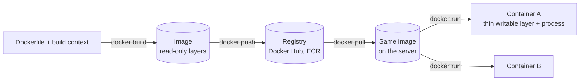
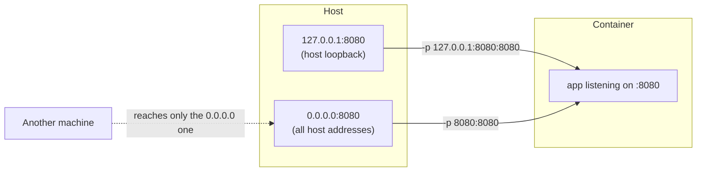
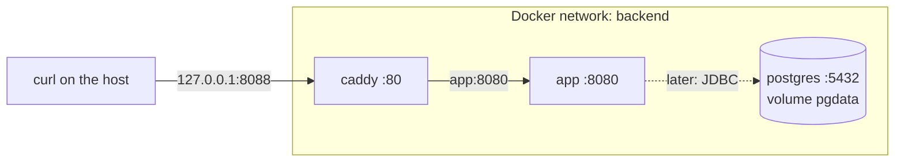

# L02 — Containers with Docker

Lesson for [[../../90 - Tasks/items/LEARN-002-containers-docker|LEARN-002]].
Progress: [[Deployment Learning Tracker#L02 - Containers with Docker]].
Roadmap: [[00 - Deployment Roadmap]]. Previous: [[L01 - Linux Shell and Networking]].

> [!info] How to read this lesson
> Every command output in this lesson was **observed** on the development
> machine on 2026-10-07 (Fedora, Docker Engine 29.7.2, amd64, the image
> built from `main`), unless it is marked *expected*. IDs, timings and sizes
> will differ on your machine, but the shape of the output should match. The
> Docker Compose plugin was not installed on the dev machine, so the Compose
> lab was run with the equivalent plain `docker` commands, and the
> `docker compose` output is *expected*.

## 1. Why this matters

On the server the app will not run as `./build/install/.../bin/...`. It will
run as a **container**, started from an **image** that CI builds once and
the server pulls. When something fails during a deploy, you will need to
answer:

- Which image is running, and is it the one I think it is (tag vs digest)?
- Is the container up, healthy, restarting, or killed for using too much memory?
- Which ports are published, to whom, and can the proxy reach the app?
- What does the app log, and what is inside the container?

This module answers all of these with commands you can run locally first.

## 2. The mental model



| Term | What it is | Analogy |
|---|---|---|
| **Image** | a read-only stack of filesystem **layers** plus metadata (user, ports, entrypoint, health check) | a class, or an installer |
| **Container** | a running (or stopped) instance: the image layers + a thin writable layer + one main process | an object, or an installed program |
| **Registry** | a server that stores images by name | a package repository |
| **Tag** | a movable label such as `:local`, `:21-jre-jammy`, `:latest` | a Git branch name |
| **Digest** | `sha256:…` of the image content; it cannot change | a Git commit hash |

A container is **not** a virtual machine. It is an ordinary Linux process
that the kernel isolates with *namespaces* (its own view of PIDs, network,
mount points, hostname) and limits with *cgroups* (memory and CPU). It shares
the host kernel. That is why it starts in about a second, and also why an
image built for `amd64` cannot run directly on an `arm64` machine (section 9).

## 3. The project's Dockerfile, line by line

```dockerfile
FROM eclipse-temurin:21-jdk-jammy AS build          # ① build stage: full JDK
WORKDIR /workspace
COPY gradlew build.gradle.kts settings.gradle.kts gradle.properties ./
COPY gradle/ gradle/
COPY config/ config/
COPY src/main/ src/main/
COPY sparql/ sparql/
RUN ./gradlew installDist --no-daemon                # ② compile + package

FROM eclipse-temurin:21-jre-jammy                    # ③ runtime stage: JRE only

RUN apt-get update \
    && apt-get install -y --no-install-recommends curl \
    && rm -rf /var/lib/apt/lists/*                   # ④ curl for the health check

COPY --from=build /workspace/build/install/sparql-query-easy-kotlin/ /opt/sparql-query-easy/   # ⑤

USER 10001:10001                                     # ⑥ not root
EXPOSE 8080                                          # ⑦ documentation only
HEALTHCHECK --interval=30s --timeout=5s --start-period=30s --retries=3 \
    CMD curl --fail --silent --show-error http://127.0.0.1:8080/health >/dev/null || exit 1   # ⑧
ENTRYPOINT ["/opt/sparql-query-easy/bin/sparql-query-easy-kotlin"]   # ⑨
```

1. **Multi-stage build.** The first stage has a full JDK, Gradle and the
   sources. Only its *output* is copied into the second stage, so
   compilers, Gradle caches and sources never reach the final image.
2. `installDist` is the same command you ran by hand in L01. It produces
   `bin/` (launcher script) and `lib/` (all JARs).
3. The runtime base has only a **JRE**, which is smaller and has less attack
   surface than a JDK.
4. Each `RUN` creates a layer. Removing the apt lists *in the same `RUN`*
   keeps them out of the layer. In a later `RUN` they would still be stored
   in the earlier layer. Observed: the Temurin image already ships `curl`
   (`dpkg -l curl` → `7.81.0-1ubuntu1.29`), so this layer adds 0 B. It still
   documents that the health check depends on curl.
5. `COPY --from=build` takes files from the first stage.
6. `USER 10001:10001` makes the process run as a numeric user that has no
   account and owns nothing. If the app is compromised, the attacker is not
   root inside the container.
7. `EXPOSE` **does not publish** anything. It is metadata that says "this
   image listens on 8080". Publishing is `-p` at run time (section 6).
8. `HEALTHCHECK` makes Docker run `curl /health` inside the container every 30 s
   and mark it `healthy` or `unhealthy` (section 5).
9. `ENTRYPOINT` in *exec form* (a JSON array) runs the launcher without a
   shell wrapper. The launcher then `exec`s Java, so **Java is PID 1** and
   receives `SIGTERM` from `docker stop` directly (observed in section 5).

### The build context and `.dockerignore`

`docker build … .` sends the directory `.` (the **build context**) to the
builder. `.dockerignore` removes things the image never needs:

```text
.git  .github  .gradle  .idea  build  node_modules  …
Sparql.QueryEasy  compatibility  files  frontend-tests  tcc
src/test  src/integrationTest  *.pdf
```

The old C# tree, captures, this vault, tests and PDFs are excluded. This
makes the context faster to send, keeps the cache stable (editing a note in
`tcc/` does not invalidate a `COPY`), and prevents leaks: a stray `.env` or
key file that is not ignored and gets picked up by a `COPY` ends up in the
image.

## 4. Lab part A — build, and what the cache reuses

```sh
time docker build -t sparql-query-easy:local .
```

A **cold** build (`--no-cache`) observed, abridged:

```text
#10 [stage-1 2/3] RUN apt-get update && apt-get install -y … curl …   DONE 14.4s
#15 [build 8/8] RUN ./gradlew installDist --no-daemon                  DONE 121.7s
#16 [stage-1 3/3] COPY --from=build /workspace/build/install/…         DONE 0.4s
docker build --no-cache …  2:11,36 total
```

Running the same build again with nothing changed takes **2.7 s**: every
step says `CACHED`.

Now change **only a frontend file** (one comment appended to
`sparql/grafos.css`) and rebuild:

```text
#8  [build 2/8] WORKDIR /workspace                  CACHED
#10 [build 3/8] COPY gradlew build.gradle.kts …     CACHED
#9  [build 4/8] COPY gradle/ gradle/                CACHED
#11 [build 5/8] COPY config/ config/                CACHED
#12 [build 6/8] COPY src/main/ src/main/            CACHED
#13 [build 7/8] COPY sparql/ sparql/                DONE 0.5s
#14 [build 8/8] RUN ./gradlew installDist …         DONE 109.6s
#15 [stage-1 2/3] RUN apt-get update …              CACHED
#16 [stage-1 3/3] COPY --from=build …               DONE 0.2s
docker build …  1:56,03 total
```

**The cache rule:** a step is reused if its instruction *and its inputs*
did not change **and** every step before it was reused. Once one step
misses, every later step in that stage runs again.

So a one-line CSS change re-ran the 110-second Gradle step. That step
downloads Gradle itself and every dependency **each time**, because nothing
cached inside `RUN` survives a rebuild. Two common improvements (not applied
here, ideas for OPS-005):

- Copy the build files first and run a dependency-only step before
  `COPY src/` (the classic "dependency layer").
- Use a BuildKit cache mount: `RUN --mount=type=cache,target=/root/.gradle ./gradlew installDist`.

The runtime stage reused its `apt-get` layer because its inputs (base image
and command) did not change, even though the app changed.

### What is in the image

```sh
docker image ls sparql-query-easy
docker image history sparql-query-easy:local
```

```text
IMAGE                     ID             DISK USAGE   CONTENT SIZE
sparql-query-easy:local   65850a3d8af6        473MB          132MB

CREATED BY                                      SIZE
ENTRYPOINT ["/opt/sparql-query-easy/bin/spar…   0B
HEALTHCHECK {Test:[CMD-SHELL curl --fail --s…   0B
EXPOSE [8080/tcp]                               0B
USER 10001:10001                                0B
COPY /workspace/build/install/sparql-query-e…   36.5MB    ← our app: 89 JARs
RUN /bin/sh -c apt-get update     && apt-get…   0B        ← curl already there
RUN /bin/sh -c set -eux;     ARCH="$(dpkg --…   166MB     ← the Java runtime
RUN /bin/sh -c set -eux;     apt-get update;…   52.7MB    ← Temurin's OS packages
/bin/sh -c #(nop) ADD file:b0bf3f64519bf10a5…   85.8MB    ← Ubuntu 22.04 (jammy)
```

- **Disk usage** (473 MB) is unpacked on disk. **Content size** (132 MB)
  is compressed, which is roughly what a registry stores and a server
  downloads.
- Only **36.5 MB** is our app. The rest is Ubuntu and the JRE, which are
  shared with every other image built on the same base. A deploy that
  changes only the app downloads only that layer.
- Metadata lines (`USER`, `EXPOSE`, …) are 0 B layers.

```sh
docker image inspect sparql-query-easy:local --format '{{.Config.User}} {{json .Config.ExposedPorts}} {{.Architecture}}'
```

```text
10001:10001 {"8080/tcp":{}} amd64
```

## 5. Lab part B — run, health, logs, exec, stop

```sh
docker run -d --name app -p 127.0.0.1:8080:8080 --restart unless-stopped sparql-query-easy:local
```

`-d` detached, `--name` lets you write `app` instead of an ID, `-p` publishes
a port (section 6), `--restart unless-stopped` restarts it after a crash or
reboot unless you stopped it yourself.

Watching the health status every 5 s:

```text
t=5s starting 0
t=10s starting 0
t=15s healthy 0
```

```sh
docker ps --format 'table {{.Names}}\t{{.Status}}\t{{.Ports}}'
```

```text
NAMES     STATUS                    PORTS
app       Up 43 seconds (healthy)   127.0.0.1:8080->8080/tcp
```

**How health works:** during the `start-period` (30 s) failures do not
count, and Docker probes more often (every 5 s by default), so a fast app
turns `healthy` early. After that it probes every `interval` (30 s); `retries`
(3) consecutive failures make it `unhealthy`. `docker inspect app --format
'{{json .State.Health.Log}}'` shows the last probes with exit codes.

> [!warning] Docker does not act on `unhealthy`
> Plain Docker only *reports* the health status. It does not restart an
> unhealthy container. Restart policies react to the **process exiting**.
> Compose `depends_on: condition: service_healthy`, load balancers and
> orchestrators (ECS) are what act on health.

### Logs

```sh
docker logs --since 5m -f app
```

```text
SLF4J(W): No SLF4J providers were found.
SLF4J(W): Defaulting to no-operation (NOP) logger implementation
SLF4J(W): See https://www.slf4j.org/codes.html#noProviders for further details.
```

`docker logs` shows what the main process writes to **stdout/stderr**. This
is the L01 finding again: with no SLF4J backend the app logs nothing, so you
do **not** see Ktor's `Responding at http://0.0.0.0:8080` line that the
task card expected. Until OPS-004 adds a logging backend, health and `curl`
are your only signals. In a container, log to stdout, not to files: Docker
(and later CloudWatch) collects stdout.

### Inside the container

```sh
docker exec app id
docker exec app ls /opt/sparql-query-easy
docker exec app sh -c 'ls /opt/sparql-query-easy/lib | wc -l'
docker exec app ps -o pid,user,rss,args
docker exec app touch /opt/sparql-query-easy/x
```

```text
uid=10001 gid=10001 groups=10001
bin
lib
89
    PID USER       RSS COMMAND
      1 10001    34748 /opt/java/openjdk/bin/java -classpath /opt/sparql-query-easy/lib/…
touch: cannot touch '/opt/sparql-query-easy/x': Permission denied
```

- The user is 10001, as the image said.
- **Java is PID 1.** In a container, PID 1 is the process whose exit ends
  the container, and the one that receives `docker stop`'s signal.
- The app user cannot write into its own install directory, so a
  compromised app cannot replace its JARs.
- `docker exec -it app sh` gives you an interactive shell. Use it to look
  around, not to "fix" things: any change is lost when the container is
  replaced, and the next deploy would not have it.

### Resource use and disk

```sh
docker stats --no-stream app
docker system df
```

```text
NAME   CPU %   MEM USAGE / LIMIT     MEM %   PIDS
app    0.21%   23.89MiB / 7.622GiB   0.31%   36

TYPE            TOTAL     ACTIVE    SIZE      RECLAIMABLE
Images          20        4         1.601GB   27.25MB (1%)
Build Cache     175       0         5.803GB   5.413GB
```

- `LIMIT 7.622GiB` means **no memory limit**: the container may use all of
  the host's memory (section 7). The low 24 MiB was observed on a dev machine
  under memory pressure. Expect a JVM to use 150–250 MiB after startup, as
  the L01 process did.
- The **build cache** used 5.8 GB on the dev machine. Old images and build
  cache are the usual reason a small server's disk fills up. Clean with
  `docker image prune` and `docker builder prune`, after reading what they
  will delete.

### Stopping gracefully

```sh
time docker stop app
docker inspect app --format '{{.State.Status}} exit={{.State.ExitCode}}'
```

```text
docker stop app  … 2,796 total
exited exit=143
```

`docker stop` sends `SIGTERM`, waits (10 s by default), then `SIGKILL`.
Exit code **143 = 128 + 15**: the process ended because of signal 15
(TERM), which is a clean shutdown. **137 = 128 + 9** means it was killed with
`SIGKILL`, by the stop timeout or by the out-of-memory killer (next
sections).

## 6. Ports and networks

### Publishing: `-p host_address:host_port:container_port`



- `-p 127.0.0.1:8080:8080`: only this machine can connect.
- `-p 8080:8080`: same as `0.0.0.0:8080:8080`, **every** network the host is
  on can connect. On Linux, Docker adds its own firewall (iptables/nftables)
  rules for published ports, so a published port can be reachable even if
  you thought the host firewall blocked it. On AWS the security group still
  applies in front of the instance (LEARN-004).
- No `-p` at all: the port is reachable only from other containers on the
  same Docker network. **This is what the app will use on the server.** Only
  the reverse proxy publishes 80/443.

### Container networks and DNS names

On a **user-defined network** (`docker network create …`, or the default
network Compose creates), Docker runs a small DNS server at `127.0.0.11`
inside each container that resolves **container names**:

```text
$ docker exec lab-caddy getent hosts lab-app lab-postgres
172.18.0.2        lab-app  lab-app
172.18.0.4        lab-postgres  lab-postgres
```

So the proxy is configured with `app:8080`, never with an IP: the IP changes
every time the container is recreated. (The built-in `bridge` network does
not resolve names. That is one reason to always create your own network.)

## 7. Memory limits and the JVM

A container without a limit can take all of the host's memory. On a 1–2 GiB
server, one leaking app can then make the kernel's OOM killer kill something
else, maybe the database. So production containers get `--memory`.

The JVM is container-aware: it reads the cgroup limit and sizes its
**default maximum heap** from it.

```sh
docker run --rm --entrypoint java sparql-query-easy:local -XX:+PrintFlagsFinal -version | grep ' MaxHeapSize '
docker run --rm --memory 256m --entrypoint java sparql-query-easy:local -XX:+PrintFlagsFinal -version | grep -E ' MaxHeapSize | MaxRAMPercentage '
```

```text
size_t MaxHeapSize = 2046820352     ← no limit: 25% of the host's 7.6 GiB
size_t MaxHeapSize = 132120576      ← --memory 256m: 126 MiB
double MaxRAMPercentage = 25.000000
```

With a normal amount of memory the default is `MaxRAMPercentage` = **25 %**.
For very small limits the JVM uses a larger fraction (`MinRAMPercentage`,
50 %), which is why 256 MiB gives 126 MiB. 25 % is conservative for a
container that only runs Java.

**Heap is not all of Java's memory.** The JVM also needs metaspace (class
metadata, and this app loads Jena and Ktor), thread stacks, the JIT code
cache and direct buffers. A rule of thumb: heap ≤ 60–75 % of the limit.

### Break it: a heap bigger than the container

```sh
docker run -d --name app-oom --memory 256m --memory-swap 256m \
  -e JAVA_OPTS="-Xms1g -Xmx1g -XX:+AlwaysPreTouch" sparql-query-easy:local
docker ps -a --filter name=app-oom --format '{{.Status}}'
docker inspect app-oom --format 'exit={{.State.ExitCode}} oomkilled={{.State.OOMKilled}}'
```

```text
Exited (137) 9 seconds ago
exit=137 oomkilled=true
```

`-Xms1g -XX:+AlwaysPreTouch` makes the JVM actually touch 1 GiB at startup,
so the kernel kills it at once. **With only `-Xmx1g` it would start fine**
and die later under load, when the heap grows past 256 MiB. This is worse,
because the startup test passes. `--memory-swap` equal to `--memory` means
"no swap on top", so the failure is immediate instead of slow.

With `--restart unless-stopped` it becomes a **crash loop**:

```text
Up Less than a second (health: starting)
restarts=7 oomkilled=false
```

In 20 s it restarted 7 times (Docker waits longer between restarts each
time). `OOMKilled` describes only the most recent exit, so look at
`RestartCount`, `docker events` and `journalctl -k | grep -i oom` on the host.

### Fix it

Size the heap relative to the limit instead of hard-coding it:

```sh
docker run -d --name app --restart unless-stopped --memory 256m --memory-swap 256m \
  -e JAVA_OPTS="-XX:MaxRAMPercentage=60" -p 127.0.0.1:8080:8080 sparql-query-easy:local
```

```text
app Up 20 seconds (healthy)
size_t MaxHeapSize = 161480704      ← 154 MiB = 60% of 256 MiB
app   135.6MiB / 256MiB   52.98%     ← after startup and one page load
```

256 MiB is tight for this app (it loads Jena, and the user's graph and
query caches live in memory). A starting point for a small server is
`--memory 512m` with `-XX:MaxRAMPercentage=60`. Measure with `docker stats`
under real use before you choose an instance size (LEARN-005).

## 8. Configuration, secrets, volumes

### Environment variables

`-e NAME=value` and `--env-file file` pass configuration at **run** time.
The launcher reads `JAVA_OPTS`. The app itself defines no other variables
yet (SEC-001, AUTH-000 and LEARN-009 will add them).

### Why secrets never go into the image

1. **Images are copied everywhere**: to CI, the registry, every server and
   every laptop that pulls them. Anyone who can pull the image can read
   every file and every `ENV` in it.
2. **Layers are permanent.** `COPY .env` followed by `RUN rm .env` still
   ships the file in the earlier layer. `docker image history` and
   `docker save` show it.
3. A secret in an image cannot be **rotated** without rebuilding and
   redeploying, and old images keep the old secret forever.

Environment variables are better, but not secret either:

```text
$ docker run -d --name leak -e DB_PASSWORD=hunter2 … ; docker inspect leak --format '{{range .Config.Env}}{{println .}}{{end}}'
DB_PASSWORD=hunter2
```

Anyone who can run `docker inspect` sees them, and they end up in shell
history. The better pattern, used by the official PostgreSQL image, is a
**file mounted at run time** plus a `_FILE` variable that points to it:

```text
POSTGRES_PASSWORD_FILE=/run/secrets/db_password    ← inspect shows the path, not the password
```

LEARN-009 moves this to AWS (SSM Parameter Store / Secrets Manager).

### Volumes vs bind mounts

| | Named **volume** `-v pgdata:/var/lib/postgresql/data` | **Bind mount** `-v /host/path:/in/container` |
|---|---|---|
| Who manages it | Docker (`docker volume ls`) | you, it is a host path |
| Typical use | database files | config files, secret files, dev code |
| Survives `docker rm` | yes | yes (it is just a host directory) |

The container's own writable layer is **deleted** with the container.
This app keeps no durable data: uploaded graphs and caches live in memory
and are lost on restart (see [[../Local JVM and Container Runtime]]), so the
app gets **no** volume. PostgreSQL does.

## 9. Architectures, tags and digests

### amd64 vs arm64

```sh
docker buildx imagetools inspect eclipse-temurin:21-jre-jammy | grep Platform
```

```text
Platform:    linux/amd64
Platform:    linux/arm64/v8
Platform:    linux/ppc64le
Platform:    linux/s390x
```

The base image is a **multi-platform index**: Docker pulls the variant that
matches the machine. **Your** image is built for the machine that builds it
(`amd64` here). AWS Graviton instances (`t4g`) are `arm64` and cheaper.
An `amd64` image fails there with `exec format error`. Fix it by building on
an arm64 machine/CI runner or with
`docker buildx build --platform linux/arm64 …` (*expected*; it needs QEMU
emulation or a native builder). Choose the instance type in LEARN-005
before setting up CI in LEARN-012.

### Tags move, digests do not

```text
$ docker image ls --digests --format '{{.Repository}}:{{.Tag}} {{.Digest}}'
sparql-query-easy:local sha256:65850a3d8af6542715b307a1e8bcccbed3929a43a4d46b8746445babeed1bda2
postgres:17 sha256:ae69c452f483507a6b99fb654cf93aad7fe156ffd2c56247707eef4e36d3c12b
```

`eclipse-temurin:21-jre-jammy` points to a new image whenever Temurin or
Ubuntu ships a patch. Observed: the base layers were "5 days ago" and
"12 days ago" old. This is good (security fixes) and bad (a rebuild with no
code change can behave differently).

- **Deploy by digest** (`image@sha256:…`): the server runs exactly the bytes
  CI tested, and a rollback means pointing back to the previous digest.
- **Pin base images by digest** in the Dockerfile
  (`FROM eclipse-temurin:21-jre-jammy@sha256:f04f…`), and update them on
  purpose with a bot such as Dependabot. The build log shows the digest it
  resolved: `FROM docker.io/library/eclipse-temurin:21-jre-jammy@sha256:f04fb34e…`.
- **Scan** images for known vulnerabilities (`docker scout cves`, Trivy, or
  ECR's scanning in LEARN-006).

## 10. Lab part C — app + PostgreSQL + Caddy with Compose

Goal: the same shape as the server. Three services share one private network,
and **only Caddy publishes a port**.



The app does not use PostgreSQL yet (LEARN-007/AUTH-000). The database is in
the lab so you practise the network, volume and secret patterns now.

In your scratch folder (**not** in the repository), create
`db_password.txt` and `compose.yaml`:

```sh
mkdir -p ~/lab/compose && cd ~/lab/compose
umask 077; head -c 24 /dev/urandom | base64 > db_password.txt
```

```yaml
name: easyquery-lab

services:
  app:
    image: sparql-query-easy:local
    environment:
      JAVA_OPTS: "-XX:MaxRAMPercentage=60"
    mem_limit: 384m
    restart: unless-stopped
    networks: [backend]
    # no "ports:" — the app is reachable only inside the network

  postgres:
    image: postgres:17
    environment:
      POSTGRES_DB: easyquery
      POSTGRES_USER: easyquery
      POSTGRES_PASSWORD_FILE: /run/secrets/db_password
    secrets: [db_password]
    volumes:
      - pgdata:/var/lib/postgresql/data
    healthcheck:
      test: ["CMD-SHELL", "pg_isready -U easyquery -d easyquery"]
      interval: 5s
      retries: 10
    restart: unless-stopped
    networks: [backend]

  caddy:
    image: caddy:2
    command: caddy reverse-proxy --from :80 --to app:8080
    ports:
      - "127.0.0.1:8088:80"
    depends_on:
      app:
        condition: service_healthy
    restart: unless-stopped
    networks: [backend]

networks:
  backend: {}

volumes:
  pgdata: {}

secrets:
  db_password:
    file: ./db_password.txt
```

> [!tip] Installing Compose
> `docker compose` is a CLI plugin. On the dev machine only `docker-buildx`
> was installed (`ls /usr/libexec/docker/cli-plugins`) and
> `docker compose up -d` failed with `unknown shorthand flag: 'd' in -d`.
> That message means "the `compose` subcommand does not exist". On Fedora,
> install the `docker-compose` package (*expected*; check with
> `docker compose version`).

```sh
docker compose up -d
docker compose ps
```

*Expected:* three services; `app` and `postgres` become `healthy`; only
`caddy` shows `127.0.0.1:8088->80/tcp`. `caddy` starts after `app` is
healthy because of `depends_on: condition: service_healthy`.

### What the same setup did on the dev machine (plain `docker`)

```sh
docker network create lab-backend
docker run -d --name lab-app --network lab-backend --memory 384m -e JAVA_OPTS="-XX:MaxRAMPercentage=60" sparql-query-easy:local
docker run -d --name lab-postgres --network lab-backend … -v "$PWD/db_password.txt:/run/secrets/db_password:ro,z" -v lab-pgdata:/var/lib/postgresql/data postgres:17
docker run -d --name lab-caddy --network lab-backend -p 127.0.0.1:8088:80 caddy:2 caddy reverse-proxy --from :80 --to lab-app:8080
```

```text
NAMES       STATUS                        PORTS
lab-caddy   Up 25 seconds                 443/tcp, 2019/tcp, 443/udp, 127.0.0.1:8088->80/tcp
lab-app     Up About a minute (healthy)   8080/tcp
```

Through Caddy, and directly:

```text
$ curl -sS -i http://127.0.0.1:8088/health
HTTP/1.1 200 OK
Content-Length: 15
Content-Type: application/json
Via: 1.1 Caddy
{"status":"ok"}

$ curl -sS http://127.0.0.1:8080/health
curl: (7) Failed to connect to 127.0.0.1 port 8080 after 0 ms: Could not connect to server
```

The `Via: 1.1 Caddy` header proves that the answer passed through the
proxy. Port 8080 is listed as `8080/tcp` with no arrow, so it is **not
published**, and the host gets "refused" (L01). That is the intended
production shape.

Stop the app and ask again:

```text
$ docker stop lab-app; curl -sS -o /dev/null -w '%{http_code}\n' http://127.0.0.1:8088/health
502
$ docker logs lab-caddy | grep error
{"level":"error",…,"msg":"dial tcp: lookup lab-app on 127.0.0.11:53: no such host",…}
```

**502 Bad Gateway** means the proxy is fine and its upstream is not.
Caddy's log says why: a stopped container disappears from Docker's DNS
(`127.0.0.11`). On a server this is the first thing to check when the site
shows 502.

### A Fedora surprise: SELinux and bind mounts

The first PostgreSQL start failed:

```text
/usr/local/bin/docker-entrypoint.sh: line 21: /run/secrets/db_password: Permission denied
```

`chmod 644` did **not** fix it. The cause was **SELinux**. The file had the
label `user_tmp_t`, and containers may only read files labelled
`container_file_t`. Adding `,z` to the mount option makes Docker relabel
the file:

```text
before: unconfined_u:object_r:user_tmp_t:s0       db_password.txt
after:  system_u:object_r:container_file_t:s0     db_password.txt
2026-10-07 09:47:28.674 UTC [1] LOG:  database system is ready to accept connections
```

With the label fixed, mode `600` works because the PostgreSQL entrypoint
reads the file as root before dropping privileges. Lesson: when
`Permission denied` survives a `chmod` on Fedora/RHEL (or Amazon Linux with
SELinux enforcing), check `ls -Z` and `ausearch -m avc` / `journalctl -t setroubleshoot`.
Compose's `secrets:` with a `file:` source is a bind mount underneath, so
the same applies.

Clean up:

```sh
docker compose down          # keeps the pgdata volume
docker compose down -v       # also deletes the volume (the database!)
```

## 11. Common errors and how to read them

| Message / symptom | Read it as | First check |
|---|---|---|
| `Exited (137)`, `OOMKilled=true` | killed by the kernel for exceeding the memory limit | `docker inspect … .State.OOMKilled`, `docker stats`, heap vs limit |
| `Exited (137)` after `docker stop`, slow stop | ignored `SIGTERM`, killed after the timeout | is the app PID 1? exec-form `ENTRYPOINT`? |
| `Exited (143)` | clean shutdown on `SIGTERM` | nothing, that is normal |
| `Restarting (…)` / high `RestartCount` | crash loop | `docker logs --tail 50`, `docker inspect … .State` |
| `(unhealthy)` | health probe fails, process still running | `docker inspect … .State.Health.Log` |
| `Bind for 127.0.0.1:8080 failed: port is already allocated` | another container or process holds the host port | `docker ps`, `ss -ltnp \| grep 8080` |
| `curl: (7)` to a container port | not published, or published on another address | `docker ps` PORTS column |
| `502` from the proxy, `no such host` | upstream container stopped or on another network | `docker ps`, `docker network inspect` |
| `exec format error` | image built for another CPU architecture | `docker image inspect … .Architecture` vs `uname -m` |
| `Permission denied` on a bind mount (Fedora/RHEL) | SELinux label | `ls -Z`, add `:z` |
| `unknown shorthand flag: 'd' in -d` on `docker compose` | Compose plugin missing | `docker compose version` |
| `no space left on device` | images/build cache filled the disk | `docker system df`, prune |
| `manifest unknown` / `pull access denied` | wrong name/tag, or not logged in to the registry | spelling, `docker login` (LEARN-006) |

## 12. Exercises — break it, then fix it

1. **Publish to everyone.** Run with `-p 8080:8080` and check `ss -ltnp | grep 8080`.
   Which address is listening now? From your phone on the same Wi-Fi, open
   `http://<your-LAN-IP>:8080/health`. Explain why the server will publish
   no app port at all.
2. **Break the health check.** Replace the entrypoint so the app never
   starts and shorten the timings:

   ```sh
   docker run -d --name broken --entrypoint sleep --health-interval 3s --health-start-period 1s sparql-query-easy:local 600
   docker inspect broken --format '{{.State.Health.Status}} failing={{.State.Health.FailingStreak}} {{(index .State.Health.Log 0).Output}}'
   ```

   Observed after 14 s:

   ```text
   Up 14 seconds (unhealthy)
   unhealthy failing=3 curl: (7) Failed to connect to 127.0.0.1 port 8080 after 0 ms: Connection refused
   ```

   Note that the container is still `Up` (section 5). Also observed:
   `--health-start-period 0s` means "use the image's default" (30 s), so the
   container stayed `starting`.
3. **OOM and fix.** Reproduce section 7, then find the smallest `--memory`
   at which the app stays healthy and serves a real query from the page.
4. **Cache.** Change a Kotlin file and then a CSS file. Which steps rebuild
   in each case? Why does the runtime stage's `apt-get` layer stay cached?
5. **Secrets.** Add `ENV DB_PASSWORD=hunter2` to a *copy* of the Dockerfile,
   build it under another tag, and find the value with
   `docker image inspect` without starting a container. Delete that image.
6. **Digest.** After pushing in LEARN-006, find the digest with
   `docker image ls --digests` and explain why `deploy image@sha256:…` is
   safer than `deploy image:latest`.

## 13. Quiz

> [!question]- 1. What is the difference between `EXPOSE 8080` and `-p 127.0.0.1:8080:8080`?
> `EXPOSE` is only metadata in the image. `-p` actually publishes the port
> on the host, here only on the loopback address.

> [!question]- 2. A one-line CSS change made the build take almost two minutes. Why?
> `COPY sparql/` changed, so every later step in that stage missed the cache,
> including `RUN ./gradlew installDist`, which downloads Gradle and all
> dependencies again because nothing inside a `RUN` is cached between builds.

> [!question]- 3. A container shows `Exited (137)`. Name two possible causes and how to tell them apart.
> The OOM killer (`docker inspect … .State.OOMKilled` is `true`), or `docker
> stop`/`kill` escalated to `SIGKILL` because the process ignored `SIGTERM`.

> [!question]- 4. The container is `(unhealthy)`. Will Docker restart it?
> No. Plain Docker only reports it. Restart policies react to the process
> exiting. A load balancer, Compose dependency or orchestrator acts on health.

> [!question]- 5. Why is `-Xmx1g` with `--memory 512m` dangerous even if the container starts fine?
> The heap may grow beyond the container limit under load, and the kernel
> kills the JVM (137) at a random later time. Size the heap relative to the
> limit (`-XX:MaxRAMPercentage=60`) and leave room for non-heap memory.

> [!question]- 6. Why can Caddy reach `app:8080` but your browser cannot reach `127.0.0.1:8080`?
> They share a user-defined Docker network with built-in DNS, and the app's
> port is not published to the host. Only Caddy publishes a port.

> [!question]- 7. You deleted a `.env` file in a later `RUN rm` step. Is the secret gone from the image?
> No. It remains in the earlier layer and anyone with the image can extract
> it. Never copy secrets into the build context, and pass them at run time.

> [!question]- 8. The server is a `t4g.small` and the container exits with `exec format error`. What happened?
> The image was built for `amd64`, and Graviton is `arm64`. Build for
> `linux/arm64` (or multi-platform) or choose an x86 instance.

## 14. Done when

Tick these in the [[Deployment Learning Tracker#L02 - Containers with Docker|tracker]]:

- You can build, run, inspect and debug the app container without notes.
- Your local Compose lab starts app + PostgreSQL + Caddy and `curl` reaches the app through Caddy.
- You can explain why secrets never go into the image.

## Reading list

- Docker docs — "Get started" and "Docker overview" (images, containers,
  registries): https://docs.docker.com/get-started/
- Docker docs — Dockerfile reference (`HEALTHCHECK`, `USER`, `ENTRYPOINT`
  exec form): https://docs.docker.com/reference/dockerfile/
- Docker docs — Multi-stage builds and "Build cache" (cache invalidation,
  cache mounts): https://docs.docker.com/build/building/multi-stage/ and
  https://docs.docker.com/build/cache/
- Docker docs — Networking overview (port publishing, user-defined bridge
  networks, the firewall note): https://docs.docker.com/engine/network/
- Docker docs — Compose file reference (`depends_on`, `secrets`, `volumes`):
  https://docs.docker.com/reference/compose-file/
- Docker docs — "Resource constraints" (`--memory`, `--memory-swap`):
  https://docs.docker.com/engine/containers/resource_constraints/
- Eclipse Temurin on Docker Hub (tags, platforms):
  https://hub.docker.com/_/eclipse-temurin
- PostgreSQL official image, "Docker Secrets" (`_FILE` variables):
  https://hub.docker.com/_/postgres
- Caddy docs, `reverse-proxy` command: https://caddyserver.com/docs/command-line

## Source files

- `Dockerfile`, `.dockerignore`
- `build.gradle.kts` (`installDist`, the launcher that reads `JAVA_OPTS`)
- `src/main/resources/application.conf` (port 8080)
- `src/main/kotlin/com/example/sparqlqueryeasy/http/HttpModule.kt` (`/health`)
- [[../Local JVM and Container Runtime]]
